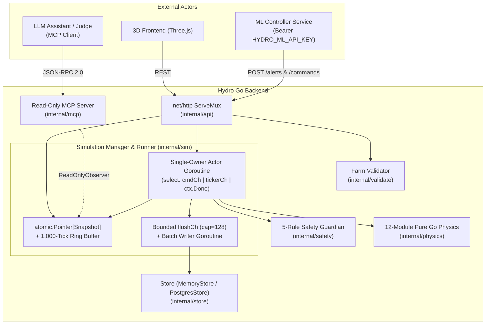

# Hydro — Recirculating NFT Lettuce Digital Twin (`Lactuca sativa` L.)

[](https://go.dev/)
[](LICENSE)

**Hydro** is an open-source, pure-Go mechanistic simulation backend, deterministic PLC safety interlock, and read-only Model Context Protocol (MCP) server for a recirculating **Nutrient Film Technique (NFT) hydroponic lettuce digital twin**, built for the **Sensor X Challenge (Egypt)**.

It enables closed-loop testing of anomaly-detection and dosing-control ML policies against a realistic Egyptian greenhouse virtual farm without risking real crops—and without requiring expensive Ion-Selective Electrodes (ISEs).

---

## Key Capabilities

1. **3D-Addressable Farm Configuration & Multi-Error Validation (`internal/validate`)**
   - Every physical component in `schema/farm.schema.json` (`enclosure`, `reservoir`, `pump`, `aerator`, `fans`, `channels[]`, `dosing_stocks`, `sensors[]`) carries a stable `id` (`component_id`).
   - Validates structural schema rules, single-field physics limits, and coupled cross-component hydraulic/geometric constraints (e.g., total plant sites vs. channel length, per-channel pump flow $\ge 0.5\text{ L min}^{-1}$, initial vs. max reservoir volume), returning **all** errors at once with `component_id` + `json_path` so a Three.js 3D frontend can highlight every offending part in red.
2. **12-Module Pure-Go Mechanistic Physics Engine (`internal/physics`)**
   - Implements all 12 coupled ODE/DAE modules from [`docs/physics/PHYSICS_SPEC.md`](docs/physics/PHYSICS_SPEC.md):
     - **Module 1:** Outdoor diurnal weather & enclosure air heat/vapor/$\text{CO}_2$ balance
     - **Module 2:** Reservoir & channel water mass conservation ($V_{\text{res}}, V_{\text{ch,tot}}$) with transpiration, evaporation, dosing, refills, and orifice leaks
     - **Module 3:** 10-ion molar mass balance ($\text{NO}_3^-, \text{NH}_4^+, \text{H}_2\text{PO}_4^-, \text{K}^+, \text{Ca}^{2+}, \text{Mg}^{2+}, \text{SO}_4^{2-}, \text{Na}^+, \text{Cl}^-, \text{Fe}^{2+}$) + alkalinity & DIC conservation
     - **Module 4:** Davies activity coefficients ($I \le 0.1\text{ mol L}^{-1}$), exact 1D electroneutrality $\text{pH}$ root-finder, and $25^\circ\text{C}$-referenced electrical conductivity ($\text{EC}_{25}$)
     - **Module 5:** Coupled reservoir & NFT channel thermal balance ($T_{\text{res}}, T_{\text{ch,out}}$)
     - **Module 6:** Benson & Krause (1980) dissolved oxygen saturation, $K_L a(T_w)$ aeration, and Michaelis-Menten root + microbial respiration
     - **Module 7:** Manning open-channel NFT film hydraulics ($h_{\text{ch}}, v_{\text{ch}}, \tau_{\text{ch}}$) with root-mat Darcy-Forchheimer drag
     - **Modules 8–10:** Stanghellini (1987) canopy transpiration, Van Henten (1994) two-state lettuce dry-matter growth ($X_{\text{nsdw}}, X_{\text{sdw}}$), Michaelis-Menten nutrient uptake with electroneutrality root $\text{H}^+/\text{OH}^-$ exudation, and fresh-weight yield
     - **Module 11:** First-order probe lag, random-walk drift, Gaussian noise, temperature-compensation bias, and Bernoulli packet dropout—exposing **only** realistic bulk probes (`EC`, `pH`, `T_w`, `DO`, `V_res`, `T_air`, `RH`, `CO2`, `RGB`) on `/readings`
     - **Module 12:** 6 fault scenarios (`pump_degradation`, `aeration_loss`, `heat_wave`, `probe_drift`, `nutrient_imbalance`, `reservoir_leak`) with distinct multi-sensor physical signatures
3. **5-Rule Deterministic Go Safety Guardian (`internal/safety`)**
   - Every ML actuation command (`POST /api/v1/simulations/{id}/commands`) is checked inside the simulation actor goroutine before mutating physical state:
     1. Finite non-negative volume & throttle $[0,1]$ sanity bounds (+ dry-pump interlock)
     2. Tank overflow interlock ($V_{\text{res}} + \Delta V \le V_{\text{res,max}}$)
     3. Hydraulic mixing cooldown ($\Delta t \ge \max(\Delta t_{\text{step}}, 0.5\tau_{\text{loop}})$ where $\tau_{\text{loop}} = V_{\text{res}}/Q_{\text{pump}}$)
     4. Single-command shock cap ($\Delta\text{EC}_{25} \le +0.40\text{ dS m}^{-1}$, $|\Delta[\text{Alk}]| \le 0.50\text{ meq L}^{-1}$)
     5. Pre-dose speciation dry-run ($\text{pH}_{\text{pred}} \in [4.5, 7.8]$, $\text{EC}_{25,\text{pred}} \le 4.0\text{ dS m}^{-1}$)
4. **Compile-Time Read-Only MCP Server (`internal/mcp`)**
   - Serves JSON-RPC 2.0 over both `POST /mcp` and `stdio` (`cmd/hydro-mcp`).
   - Wired strictly to `mcp.ReadOnlyObserver` (which defines zero mutation methods), exposing `get_farm_spec`, `get_sensor_readings`, `get_alerts`, and `get_ml_decisions`.

---

## Architecture & Go Concurrency Model



- **Zero Shared-State Locks on Physics State:** A single actor goroutine owns `physics.State`, `activeFaults`, and the seeded PCG PRNG (`math/rand/v2`), eliminating data races across the 10-ion DAE solver and ODE integrator.
- **Lock-Free Hot Reads:** After each tick, the actor publishes an immutable `*Snapshot` via `sync/atomic.Pointer` and appends to a 1,000-tick ring buffer.
- **Bounded Telemetry Backpressure:** Live ticks enqueue batches onto `flushCh` (`cap=128`); if Postgres stalls, the oldest batch is dropped, `dropped_batches` is incremented, and a `slog.Warn` is logged so physics ticks never block on disk I/O. Synchronous `/advance` flushes with a context timeout so fast-forward ML training datasets are 100% lossless.

---

## Quickstart

### 1. Run Locally (Zero External Dependencies)
```bash
make test
make run
```
When `HYDRO_DATABASE_URL` is unset, `hydro` starts immediately on `:8080` using the thread-safe in-memory store and seeds the baseline Egyptian NFT lettuce farm (`Sensor X Cairo NFT Lettuce Twin (1x Baseline)`).

### 2. Run with Docker Compose (Backend + Database + ML Agent)
Launch the complete digital twin stack including Go Core (`:8080`), PostgreSQL (`:5432`), and the Python ML Autonomous Agent:

```bash
docker compose up -d --build
```

- Watch ML agent diagnostics in real time: `docker compose logs -f hydro-agent`
- Access the Web Control Dashboard: [http://localhost:8080](http://localhost:8080)
- Detailed startup and log viewing instructions: [`docs/ML docs/how to start.md`](docs/ML%20docs/how%20to%20start.md)

### 3. Try the 5-Act Competition Demo Flow via `curl`

```bash
# 1. Validate & create a farm from testdata/valid_farm.json
FARM_ID=$(curl -s -X POST http://localhost:8080/api/v1/farms \
  -H "Content-Type: application/json" \
  -d @testdata/valid_farm.json | jq -r '.id')

# 2. Launch a deterministic simulation (seed=42, 300s step) and fast-forward 24 steps (2 hours)
SIM_ID=$(curl -s -X POST http://localhost:8080/api/v1/simulations \
  -H "Content-Type: application/json" \
  -d "{\"farm_id\":\"$FARM_ID\",\"seed\":42,\"step_seconds\":300,\"mode\":\"paused\"}" | jq -r '.id')

curl -s -X POST "http://localhost:8080/api/v1/simulations/$SIM_ID/advance" \
  -H "Content-Type: application/json" \
  -d '{"steps": 24}' | jq .

# 3. Inspect noisy bulk sensor readings (EC, pH, T_w, DO, V_res, T_air, RH, RGB)
curl -s "http://localhost:8080/api/v1/simulations/$SIM_ID/readings?limit=8" | jq .

# 4. Submit a safe ML nutrient dose (200 OK - accepted) vs. an unsafe acid overdose (422 - rejected_safety)
curl -s -X POST "http://localhost:8080/api/v1/simulations/$SIM_ID/commands" \
  -H "Authorization: Bearer dev-ml-secret-key" \
  -H "Content-Type: application/json" \
  -d '{"target_component_id":"reservoir-1","action":"dose","dose_stock_a_ml":15,"dose_stock_b_ml":15,"reason":"Maintain EC25"}' | jq .

curl -s -X POST "http://localhost:8080/api/v1/simulations/$SIM_ID/commands" \
  -H "Authorization: Bearer dev-ml-secret-key" \
  -H "Content-Type: application/json" \
  -d '{"target_component_id":"reservoir-1","action":"dose","dose_acid_ml":500,"reason":"Hallucinated acid dump"}' | jq .

# 5. Query the read-only MCP endpoint for the ML + safety guardian audit log
curl -s -X POST http://localhost:8080/mcp \
  -H "Content-Type: application/json" \
  -d "{\"jsonrpc\":\"2.0\",\"id\":1,\"method\":\"tools/call\",\"params\":{\"name\":\"get_ml_decisions\",\"arguments\":{\"simulation_id\":\"$SIM_ID\"}}}" | jq .
```

---

## Scientific Scope & Documented Limitations

Per [`docs/physics/LIMITATIONS.md`](docs/physics/LIMITATIONS.md) and [`docs/physics/GAP_REGISTER.md`](docs/physics/GAP_REGISTER.md):
- **Single-Crop Calibration:** Crop growth and Michaelis-Menten uptake parameters are calibrated specifically for hydroponic lettuce (*Lactuca sativa* L.) from transplant to vegetative harvest ($28\text{–}35\text{ days}$).
- **Ionic Strength Regime:** Davies activity coefficients are valid for standard and brackish hydroponic solutions ($I \le 0.1\text{ mol L}^{-1}$, $\text{EC} \le 5\text{ dS m}^{-1}$).
- **Lumped Enclosure & 1D Plug-Flow Approximations:** Greenhouse air is modeled as a single well-mixed zone (no 3D CFD), and NFT channels use steady Manning kinematics with plug-flow thermal/DO relaxation ($\Delta t = 300\text{ s} \gg \tau_{\text{ch}}$).
- **Calibrated Proxies for Unresolved Literature Gaps (`G1`–`G6`):** Individual non-N/P/K secondary ion $K_m$ values, root-mat Darcy-Forchheimer drag ($C_{\text{root,drag}}$), salinity-induced dry-matter partitioning, and root acid/base exudation stoichiometric weights are marked `[CALIBRATED-PROXY]` in [`docs/physics/PARAMETER_REGISTRY.md`](docs/physics/PARAMETER_REGISTRY.md).

---

## Documentation Index

- [`docs/ML docs/how to start.md`](docs/ML%20docs/how%20to%20start.md) — Comprehensive Docker Compose startup and log monitoring guide
- [`hydro_agent/README.md`](hydro_agent/README.md) — Python ML Diagnostic & Control Suite architecture, model registry, and tests
- [`hydro_agent/ml_edits.md`](hydro_agent/ml_edits.md) — Complete release engineering log and REST flow endpoint matrix
- [`docs/REQUIREMENTS.md`](docs/REQUIREMENTS.md) — MoSCoW requirements, actors, NFRs, and 5-Act acceptance demo script
- [`docs/ARCHITECTURE.md`](docs/ARCHITECTURE.md) — Package layout, concurrency design, 5 safety rules, and PostgreSQL schema
- [`openapi.yaml`](openapi.yaml) — OpenAPI 3.1 REST & `/mcp` specification
- [`schema/farm.schema.json`](schema/farm.schema.json) — JSON Schema (Draft 2020-12) for 3D-addressable Farm JSONs
- [`docs/physics/PHYSICS_SPEC.md`](docs/physics/PHYSICS_SPEC.md) — Complete 12-module mathematical specification and verification gates
- [`docs/adr/`](docs/adr/) — Architecture Decision Records (`ADR-001` through `ADR-004`)
