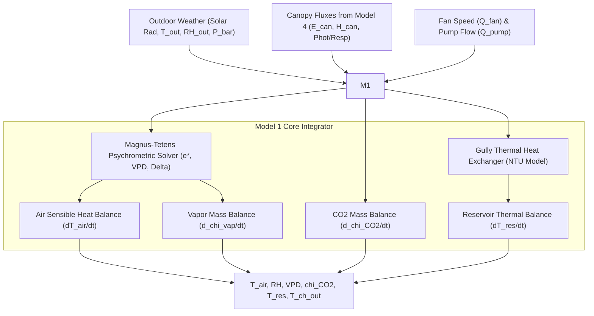

# Model 1: Enclosure Microclimate & Thermal-Vapor Dynamics Engine

**Document Version:** 1.0.0  
**Target Module:** Digital Twin Physics Core (Enclosure & Root-Zone Thermal Coupling)  
**System Layer:** Physics Simulation / Analytical Reference Observer  

---

## 1. Why We Use It
In commercial protected cultivation (NFT lettuce), internal air temperature ($T_{\text{air}}$), relative humidity ($\text{RH}$), vapor pressure deficit ($\text{VPD}$), and root-zone water temperature ($T_{\text{res}}, T_{\text{ch}}$) dictate both crop transpiration and water-nutrient uptake rates. 

Relying on black-box historical ML models requires years of site-specific historical data and fails during acute outdoor weather shifts (e.g., heat waves). Model 1 applies **first-principles conservation of energy, water vapor mass, and carbon dioxide**, enabling:
* Real-time zero-data forecasting of greenhouse microclimate under arbitrary external weather.
* Prediction of water temperature drift along shallow Nutrient Film Technique (NFT) gullies without deploying submerged thermocouples every few meters.
* Providing the primary reference states ($\hat{T}_{\text{air}}, \widehat{\text{VPD}}, \hat{T}_{\text{res}}$) used by Model 5 to isolate microclimate sensor faults and heat waves.

---

## 2. How It Works (Physical & Mathematical Principles)



### 2.1 Enclosure Sensible Heat Balance
The time rate of change of enclosure sensible heat satisfies:
$$\rho_a c_{p,a} H_{\text{enc}} \frac{dT_{\text{air}}}{dt} = Q_{\text{rad,air}} + H_{\text{can}\to\text{air}} + H_{\text{ch}\to\text{air}} - Q_{\text{vent,sens}} - Q_{\text{cov,cond}}$$

Where:
* $\rho_a = 1.20\text{ kg m}^{-3}$, $c_{p,a} = 1010\text{ J kg}^{-1}\text{ K}^{-1}$.
* $H_{\text{enc}} = \frac{V_{\text{enc}}}{A_{\text{fl}}}$ is the effective enclosure height.
* $Q_{\text{rad,air}}$ is direct solar/lamp sensible radiative absorption.
* $H_{\text{can}\to\text{air}}$ is convective heat flux from leaves (derived from Model 4).
* $H_{\text{ch}\to\text{air}} = \frac{A_{\text{ch,tot}}}{A_{\text{fl}}} U_{\text{ch,top}}(T_{\text{ch}} - T_{\text{air}})$ is heat exchange from gullies.
* $Q_{\text{vent,sens}} = \rho_a c_{p,a} \phi_{\text{vent}}(T_{\text{air}} - T_{\text{out}})$ represents ventilation heat removal.
* $Q_{\text{cov,cond}} = U_{\text{cov}} \frac{A_{\text{cov}}}{A_{\text{fl}}}(T_{\text{air}} - T_{\text{out}})$ is conduction through the greenhouse skin.

### 2.2 Enclosure Water Vapor Balance
$$\frac{d\chi_{\text{vap}}}{dt} = \frac{1}{H_{\text{enc}}} \left[ E_{\text{can}} + E_{\text{evap,free}} - \phi_{\text{vent}}(\chi_{\text{vap}} - \chi_{\text{vap,out}}) - \phi_{\text{cond,cov}} \right]$$
* $E_{\text{can}}$ is the canopy transpiration flux $[\text{kg m}^{-2}\text{ s}^{-1}]$ from Model 4.
* $\phi_{\text{cond,cov}} = \max\left(0, k_{\text{cond}}(\chi_{\text{vap}} - \chi_{\text{vap}}^*(T_{\text{cov}}))\right)$ captures condensation loss on cold cover panels.

### 2.3 Longitudinal Channel NTU Heat Exchanger Formulation
Water moving in a thin film along white PVC gullies equilibrates toward ambient air and absorbed solar radiation. To avoid numerical instability, an analytical Number of Transfer Units ($\text{NTU}$) formulation computes the channel outlet temperature algebraically:
$$T_{\text{ch,out}} = T_{\text{eq,ch}} + (T_{\text{res}} - T_{\text{eq,ch}}) \exp\left(-\frac{U_{\text{ch,top}} A_{\text{ch,tot}}}{\rho_w c_{p,w} Q_{\text{pump}}}\right)$$
$$T_{\text{eq,ch}} = T_{\text{air}} + \frac{\alpha_{\text{ch,sol}} e^{-k_{\text{ext}}\text{LAI}} I_{\text{can,sw}}}{U_{\text{ch,top}}}$$

### 2.4 Reservoir Heat Balance
$$\rho_w c_{p,w} V_{\text{res}} \frac{dT_{\text{res}}}{dt} = \rho_w c_{p,w} Q_{\text{pump}}(T_{\text{ch,out}} - T_{\text{res}}) + U_{\text{res}} A_{\text{wall}}(T_{\text{amb}} - T_{\text{res}}) + P_{\text{pump,heat}} - \lambda_v \rho_w Q_{\text{evap,res}}$$

---

## 3. Operational Model Flow
1. **Psychrometric Update:** Magnus-Tetens calculates saturation vapor pressure $e^*(T)$, absolute humidity saturation $\chi_{\text{vap}}^*$, and ambient vapor deficit $\text{VPD}$.
2. **Coupled Boundary Assembly:** Evaluates fluxes using outputs from Model 4 (transpiration $E_{\text{can}}$, sensible heat $H_{\text{can}\to\text{air}}$) and pump flow from Model 6.
3. **Channel Algebraic Solve:** Calculates $T_{\text{ch,out}}$ via the exponential NTU equation.
4. **State Integration:** Advances $[T_{\text{air}}, \chi_{\text{vap}}, \chi_{\text{CO}_2}, T_{\text{res}}]$ by step size $\Delta t$ using 4th-Order Runge-Kutta (RK4).

---

## 4. Input & Output Schemas

### Input Schema (`model1_input.json`)
```json
{
  "sim_time_sec": 86400.0,
  "delta_t_sec": 300.0,
  "outdoor_weather": {
    "shortwave_irradiance_w_m2": 650.0,
    "air_temperature_c": 28.5,
    "relative_humidity_pct": 55.0,
    "barometric_pressure_pa": 101325.0
  },
  "facility_parameters": {
    "floor_area_m2": 150.0,
    "enclosure_volume_m3": 600.0,
    "cover_transmittance": 0.75,
    "cover_heat_transfer_coeff_w_m2_k": 5.8,
    "ventilation_rate_m3_s": 1.25
  },
  "coupled_states": {
    "canopy_transpiration_kg_m2_s": 0.00012,
    "canopy_sensible_heat_w_m2": 45.2,
    "net_co2_uptake_kg_m2_s": 0.0000018,
    "pump_flow_rate_m3_s": 0.00005,
    "co2_injection_kg_m2_s": 0.0
  }
}
```

### Output Schema (`model1_output.json`)
```json
{
  "sim_time_sec": 86700.0,
  "enclosure_states": {
    "t_air_c": 24.35,
    "chi_vap_kg_m3": 0.0135,
    "relative_humidity_pct": 62.4,
    "vpd_kpa": 1.15,
    "co2_concentration_ppm": 485.2
  },
  "root_zone_states": {
    "t_res_c": 21.85,
    "t_ch_out_c": 22.40,
    "t_ch_mean_c": 22.12
  }
}
```