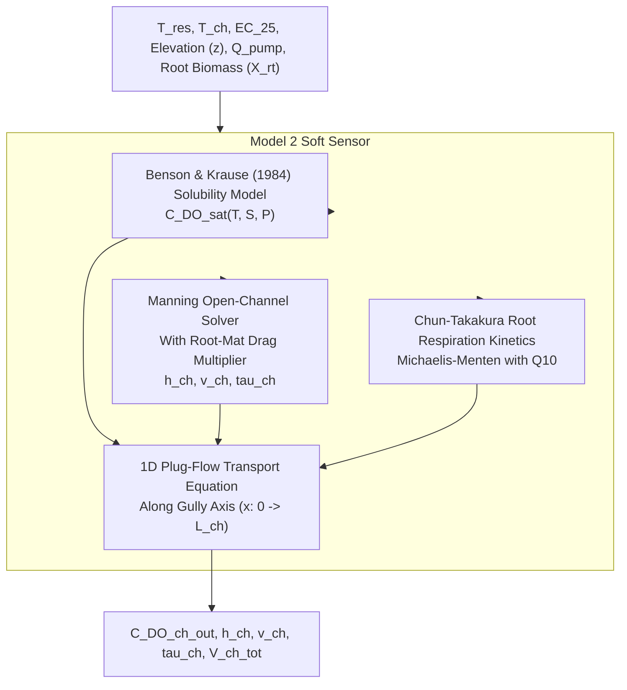

# Model 2: Dissolved Oxygen & Channel Hydraulics Soft-Sensor Observer

**Document Version:** 1.0.0  
**Target Module:** Digital Twin Virtual Sensing Layer (NFT Root-Zone Environment)  
**System Layer:** Soft-Sensor Observer / Physics Reference Generator  

---

## 1. Why We Use It
Dissolved Oxygen (DO) is vital to root respiration and active nutrient ion transport. In high-density NFT systems:
1. **Sensor Cost & Maintenance:** Optical luminescent DO sensors cost $> \$4{,}800$ per installation, foul rapidly due to biofilm growth, and require frequent recalibration.
2. **Channel Starvation:** While water in the aerated reservoir may be fully saturated ($> 8.0\text{ mg L}^{-1}$), thin nutrient films along $12\text{ m}$ gullies rapidly lose oxygen due to root respiration, potentially causing root anoxia at the gully outlet.
3. **Virtual Sensing:** Model 2 acts as an online **soft sensor** that predicts DO throughout the channel and models open-channel hydraulic film depth ($h_{\text{ch}}$) and velocity ($v_{\text{ch}}$) from first principles, eliminating the need for inline flowmeters and multiple spatial DO sensors.

---

## 2. How It Works (Physical & Mathematical Principles)



### 2.1 Dissolved Oxygen Saturation (Benson & Krause Formulation)
Calculates saturation solubility $C_{\text{DO,sat}}$ as a function of water temperature $T_K$, practical salinity $S \approx 0.55 \cdot \text{EC}_{25}$, and barometric pressure $P_{\text{atm}}$:
$$C_{\text{DO,sat}}(T_w, \text{EC}_{25}, P_{\text{atm}}) = C_{\text{DO},0}(T_K) \cdot F_S(T_K, S) \cdot F_P(T_K, P_{\text{atm}})$$
$$\ln C_{\text{DO},0}(T_K) = -139.34411 + \frac{1.575701\times 10^5}{T_K} - \frac{6.642308\times 10^7}{T_K^2} + \frac{1.243800\times 10^{10}}{T_K^3} - \frac{8.621949\times 10^{11}}{T_K^4}$$

### 2.2 Root-Mat Manning Hydraulics
Liquid film depth $h_{\text{ch}}$ and flow velocity $v_{\text{ch}}$ along shallow gullies are affected by root mass accumulation:
$$n_{\text{ch,eff}} = n_{\text{PVC}} \left(1 + c_{\text{root,drag}} \frac{X_{\text{rt,plant}}}{W_{\text{ch}} s_{\text{pl}} \rho_{\text{rt,bulk}}}\right)$$
$$h_{\text{ch}} = h_{\text{res,puddle}} + \left(\frac{n_{\text{ch,eff}} \, q_{\text{ch}}}{W_{\text{ch}} S_0^{1/2}}\right)^{3/5}, \qquad v_{\text{ch}} = \frac{q_{\text{ch}}}{W_{\text{ch}} h_{\text{ch}}}$$
Where:
* $q_{\text{ch}} = \frac{Q_{\text{pump}}}{N_{\text{ch}}}$ is flow rate per channel.
* $n_{\text{PVC}} = 0.010\text{ s m}^{-1/3}$, $c_{\text{root,drag}} = 12.0$.
* $S_0$ is gully bed slope ($0.02\text{ m m}^{-1}$).

### 2.3 Chun-Takakura Specific Root Oxygen Respiration
Root oxygen uptake rate is temperature-dependent and saturates according to Michaelis-Menten kinetics:
$$R_{\text{root},\text{O}_2} = r_{\text{O}_2,\text{ref}} \, X_{\text{rt,plant}} \, Q_{10,\text{DO}}^{(T_{\text{ch}} - 23.0)/10.0} \frac{C_{\text{DO}}}{K_{m,\text{DO}} + C_{\text{DO}}}$$
Where $r_{\text{O}_2,\text{ref}} = 7.8\times 10^{-4}\text{ g O}_2\text{ (kg root DM)}^{-1}\text{ s}^{-1}$, $Q_{10,\text{DO}} = 2.0$, and $K_{m,\text{DO}} = 1.50\text{ mg L}^{-1}$.

### 2.4 1D Channel Longitudinal Profile
Integrating advection, surface reaeration ($k_{v,\text{ch}}$), and root uptake down the gully length yields the outlet DO concentration:
$$C_{\text{DO,ch,out}} = C_{\text{DO,sat}} - \frac{N_{\text{pl,ch}} R_{\text{root},\text{O}_2}}{W_{\text{ch}} L_{\text{ch}} k_{v,\text{ch}}} + \left(C_{\text{DO,res}} - C_{\text{DO,sat}} + \frac{N_{\text{pl,ch}} R_{\text{root},\text{O}_2}}{W_{\text{ch}} L_{\text{ch}} k_{v,\text{ch}}}\right) \exp\left(-\frac{W_{\text{ch}} L_{\text{ch}} k_{v,\text{ch}}}{q_{\text{ch}}}\right)$$

---

## 3. Operational Model Flow
1. **Solubility Calculation:** Evaluates $C_{\text{DO,sat}}$ for the reservoir and channel temperatures.
2. **Hydrodynamic State Update:** Computes root drag multiplier, liquid film thickness $h_{\text{ch}}$, velocity $v_{\text{ch}}$, and holdup volume $V_{\text{ch,tot}}$.
3. **Respiration & Mass Transfer Solver:** Evaluates surface reaeration transfer velocity $k_{v,\text{ch}}$ and root respiration demand.
4. **Advection Evaluation:** Computes $C_{\text{DO,ch,out}}$. If DO drops near $K_{m,\text{DO}}$, integrates via a 3-point quadrature to capture non-linear depletion.

---

## 4. Input & Output Schemas

### Input Schema (`model2_input.json`)
```json
{
  "temperatures": {
    "t_res_c": 21.85,
    "t_ch_c": 22.40
  },
  "water_properties": {
    "ec25_ds_m": 2.02,
    "elevation_m": 7.0
  },
  "channel_geometry": {
    "num_channels": 6,
    "channel_length_m": 12.0,
    "channel_width_m": 0.15,
    "bed_slope_m_m": 0.02,
    "plants_per_channel": 12,
    "plant_spacing_m": 0.20
  },
  "operational_states": {
    "pump_flow_rate_m3_s": 0.00005,
    "reservoir_do_mg_l": 8.15,
    "root_dry_mass_kg_plant": 0.0055
  }
}
```

### Output Schema (`model2_output.json`)
```json
{
  "dissolved_oxygen": {
    "saturation_concentration_mg_l": 8.68,
    "channel_outlet_do_mg_l": 7.42,
    "channel_mean_do_mg_l": 7.78,
    "specific_root_consumption_mg_hr_plant": 14.2
  },
  "hydraulics": {
    "film_depth_mm": 3.85,
    "flow_velocity_m_s": 0.086,
    "total_channel_volume_l": 41.58,
    "residence_time_sec": 831.6
  }
}
```