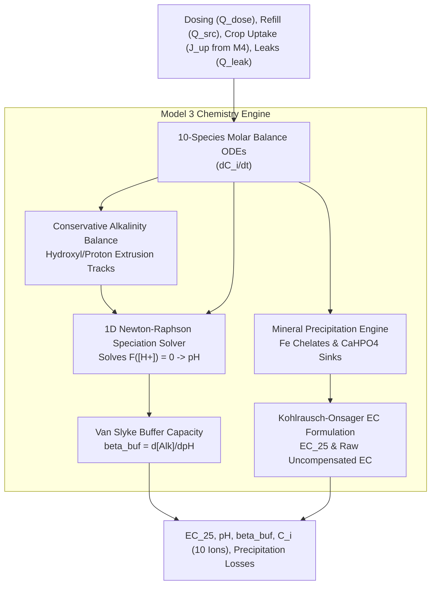

# Model 3: Solution Chemistry, Multi-Ion Speciation & pH Equilibrium Solver

**Document Version:** 1.0.0  
**Target Module:** Digital Twin Chemical Speciation Core  
**System Layer:** Physics Simulation / Chemical Observer  

---

## 1. Why We Use It
Nutrient management in closed-loop NFT systems faces complex challenges:
1. **Ion-Selective Electrode (ISE) Limitations:** Direct measurement of individual ions ($\text{NO}_3^-$, $\text{K}^+$, $\text{Ca}^{2+}$, etc.) requires ISE hardware costing $> \$8{,}500$, which suffers from severe cross-ion interference and calibration drift within days.
2. **Chemical Precipitation:** When pH rises above $7.2$, iron chelates destabilize and insoluble calcium phosphate ($\text{CaHPO}_4$) precipitates, locking up nutrients.
3. **Non-Linear pH Dynamics:** pH is not a simple linear mass concentration; it is the negative logarithm of free proton activity governed by the dissociation of carbonate, phosphate, and ammonium buffer systems.

Model 3 solves this by **tracking 10 individual ion mass balances**, computing bulk electrical conductivity via Kohlrausch-Onsager theory, and **solving the non-linear aqueous electroneutrality equation for pH and buffer capacity ($\beta_{\text{buf}}$)** using Newton-Raphson.

---

## 2. How It Works (Physical & Mathematical Principles)



### 2.1 Multi-Species Ion Molar Balances
Tracks 10 discrete ion species $\mathcal{I} = \{\text{NO}_3^-, \text{NH}_4^+, \text{H}_2\text{PO}_4^-, \text{K}^+, \text{Ca}^{2+}, \text{Mg}^{2+}, \text{SO}_4^{2-}, \text{Na}^+, \text{Cl}^-, \text{Fe}^{\text{chel}}\}$:
$$\frac{dC_i}{dt} = \frac{1}{V_{\text{tot}}} \left[ Q_{\text{src}}(C_{\text{src},i} - C_i) + \sum_{k} Q_{\text{dose},k}(C_{\text{stock},k,i} - C_i) - N_{\text{pl}} J_{\text{up},i} - R_{\text{precip},i} V_{\text{tot}} + C_i \left(\frac{A_{\text{fl}} E_{\text{can}}}{\rho_w} + Q_{\text{evap}}\right) \right]$$
* Pure water evaporation ($E_{\text{can}}$) concentrates dissolved ions ($+C_i$).
* Advective leaks carry fluid at bulk concentration, so they drop out of $dC_i/dt$.

### 2.2 Kohlrausch-Onsager Electrical Conductivity
Bulk electrical conductivity is synthesized from individual ionic equivalent conductivities:
$$\text{EC}_{25} = (1 - \alpha_{\text{OS}} \sqrt{I_{\text{str}}}) \sum_{i \in \mathcal{I}} \lambda_{0,i} \, |z_i| \, C_i, \qquad I_{\text{str}} = \frac{1}{2}\sum_{i} z_i^2 C_i \times 10^{-3}$$
$$\text{EC}_{\text{raw}}(T_w) = \text{EC}_{25} \left[1 + \alpha_{T,\text{EC}}(T_w - 25.0)\right]$$

### 2.3 Conservative Titration Alkalinity Balance
Roots extrude $\text{OH}^-$ when absorbing $\text{NO}_3^-$ and extrude $\text{H}^+$ when absorbing $\text{NH}_4^+$:
$$\frac{d(V_{\text{tot}} [\text{Alk}])}{dt} = Q_{\text{src}} [\text{Alk}]_{\text{src}} + \sum_{k} Q_{\text{dose},k} N_{\text{alk},k} + N_{\text{pl}} \left( \gamma_{\text{OH},\text{NO}_3} J_{\text{up},\text{NO}_3} - \gamma_{\text{H},\text{NH}_4} J_{\text{up},\text{NH}_4} \right) - Q_{\text{leak}} [\text{Alk}]$$

### 2.4 Implicit Electroneutrality Speciation Equation for pH
Proton activity $[\text{H}^+]$ is determined by solving the non-linear electroneutrality equation $F([\text{H}^+]) = 0$:
$$F([\text{H}^+]) \equiv [\text{Alk}] - C_T \sum_{k=1}^2 k \alpha_{k,C}([\text{H}^+]) - C_{\text{P,tot}} \sum_{j=1}^3 j \alpha_{j,P}([\text{H}^+]) + C_{\text{NH}_4} \frac{[\text{H}^+]}{[\text{H}^+] + K_{a,N}} - \frac{K_w}{[\text{H}^+]} + [\text{H}^+] = 0$$
$$\text{pH} = -\log_{10}\left(\gamma_1 [\text{H}^+] \times 10^{-3}\right)$$
Because $\frac{\partial F}{\partial [\text{H}^+]} > 0$ everywhere, Newton-Raphson iteration is unconditionally guaranteed to converge to the unique physical root within 4 to 6 iterations.

### 2.5 Van Slyke Buffer Capacity ($\beta_{\text{buf}}$)
Quantifies resistance to pH change and is supplied to Model 6 to calculate precise acid dosing:
$$\beta_{\text{buf}} = 2.303 \left( [\text{H}^+] + [\text{OH}^-] + C_T \frac{K_{a1,C} [\text{H}^+]}{([\text{H}^+] + K_{a1,C})^2} + C_{\text{P,tot}} \frac{K_{a2,P} [\text{H}^+]}{([\text{H}^+] + K_{a2,P})^2} \right)$$

---

## 3. Operational Model Flow
1. **Dynamic State Integration:** Updates 10 ion concentrations $C_i$ and alkalinity $[\text{Alk}]$ using RK4.
2. **Precipitation Checks:** Evaluates solubility products ($K_{\text{sp}}$) for $\text{Fe}$ and $\text{CaHPO}_4$ and deducts precipitates from solution.
3. **Newton-Raphson pH Solve:** Evaluates $F([\text{H}^+])$ and iterates to determine free proton activity and pH.
4. **Buffer Index & EC Update:** Calculates analytical $\beta_{\text{buf}}$, Ionic Strength $I_{\text{str}}$, $\text{EC}_{25}$, and uncompensated $\text{EC}_{\text{raw}}$.

---

## 4. Input & Output Schemas

### Input Schema (`model3_input.json`)
```json
{
  "total_volume_l": 100.0,
  "water_temperature_c": 21.85,
  "makeup_water": {
    "flow_rate_l_s": 0.0,
    "alkalinity_meq_l": 0.42,
    "ions_mmol_l": {"NO3": 0.1, "Ca": 0.8, "Mg": 0.3, "Cl": 0.5}
  },
  "dosing_actions": {
    "dose_stock_a_ml": 0.0,
    "dose_stock_b_ml": 0.0,
    "dose_acid_ml": 0.0,
    "acid_normality_eq_l": 1.0
  },
  "crop_uptake_fluxes_mol_s": {
    "NO3": 0.0000085,
    "NH4": 0.0000008,
    "H2PO4": 0.0000012,
    "K": 0.0000045,
    "Ca": 0.0000021,
    "Mg": 0.0000009
  },
  "transpiration_rate_l_s": 0.00025
}
```

### Output Schema (`model3_output.json`)
```json
{
  "bulk_properties": {
    "ec25_ds_m": 2.015,
    "ec_raw_ds_m": 1.894,
    "ph": 5.965,
    "buffer_capacity_meq_l_ph": 0.384,
    "titration_alkalinity_meq_l": 0.521,
    "ionic_strength_mol_l": 0.024
  },
  "dissolved_ions_mmol_l": {
    "NO3": 14.25,
    "NH4": 0.85,
    "H2PO4": 1.95,
    "K": 7.82,
    "Ca": 3.90,
    "Mg": 1.30,
    "SO4": 1.30,
    "Na": 0.45,
    "Cl": 0.55,
    "Fe_chel": 0.035
  },
  "precipitation_rates_mmol_s": {
    "Fe_precip": 0.0,
    "CaHPO4_precip": 0.0
  }
}
```