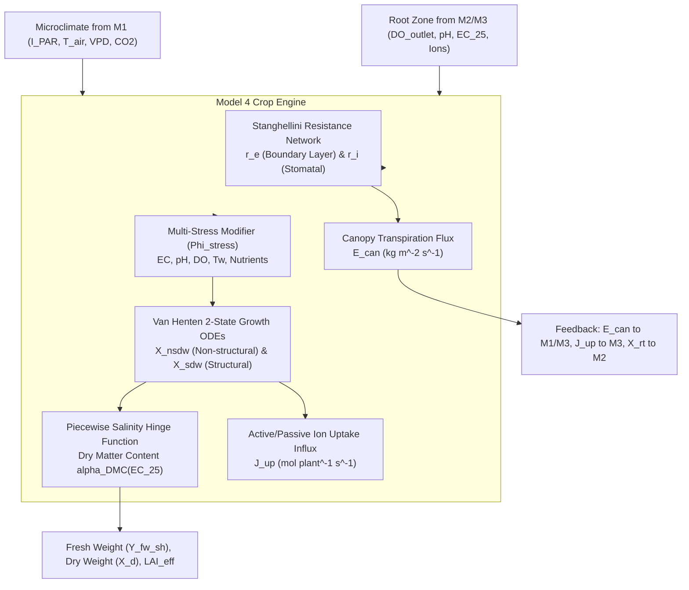

# Model 4: Stanghellini Transpiration & Van Henten Crop Biomass Engine

**Document Version:** 1.0.0  
**Target Module:** Digital Twin Crop Biological Core (Lettuce *Lactuca sativa* L.)  
**System Layer:** Biological Simulation / Agronomic Reference Engine  

---

## 1. Why We Use It
A digital twin of an NFT facility cannot treat the crop as a static water sink. Lettuce growth governs:
1. **Dynamic Water Demand:** Transpiration changes by an order of magnitude between young seedlings ($\text{LAI} < 0.2$) and mature heads ($\text{LAI} > 4.0$).
2. **Nutrient Depletion:** Nutrient removal is driven by biomass dry-matter synthesis and varies with microclimate.
3. **Harvest Value Prediction:** Yield is paid on **Shoot Fresh Weight ($Y_{\text{fw,sh}}$)**. High root-zone salinity inhibits water uptake via osmotic pressure, reducing fresh weight even if dry matter accumulation appears normal.

Model 4 integrates **Stanghellini combination transpiration** with the **Van Henten two-state dry-matter growth model** and an osmotic salinity response to eliminate the need for destructive crop sampling.

---

## 2. How It Works (Physical & Mathematical Principles)



### 2.1 Stanghellini Combination Transpiration
Penman-Monteith formulation calibrated for greenhouse multi-layer canopies:
$$\lambda_v E_{\text{can}} = \frac{\Delta(T_{\text{air}}) R_{n,\text{can}} + \dfrac{2 \, \text{LAI} \, \rho_a c_{p,a}}{r_e} (e^*(T_{\text{air}}) - e_a)}{\Delta(T_{\text{air}}) + \gamma \left(1 + \dfrac{r_i}{r_e}\right)}$$
$$r_e = \frac{1174 \, l_{\text{leaf}}^{0.5}}{\left(l_{\text{leaf}} |T_0 - T_{\text{air}}| + 207 u_{\text{can}}^2\right)^{0.25}}, \qquad r_i = r_{\min} f_1(I) f_2(T) f_3(\text{CO}_2) f_4(\text{VPD})$$

### 2.2 Two-State Crop Dry-Matter Growth (Van Henten Model)
Divides dry matter into non-structural (sugars/assimilates $X_{\text{nsdw}}$) and structural (cell walls/leaves $X_{\text{sdw}}$):
$$\frac{dX_{\text{nsdw}}}{dt} = c_\alpha \, \Phi_{\text{stress}} \, \phi_{\text{phot}} - r_{\text{gr}} X_{\text{sdw}} - \phi_{\text{resp}} - \left(\frac{1 - c_\beta}{c_\beta}\right) r_{\text{gr}} X_{\text{sdw}}$$
$$\frac{dX_{\text{sdw}}}{dt} = r_{\text{gr}} X_{\text{sdw}}, \qquad r_{\text{gr}} = c_{r,\text{gr,max}} \left(\frac{X_{\text{nsdw}}}{X_{\text{sdw}} + X_{\text{nsdw}}}\right) Q_{10,\text{gr}}^{(T_{\text{air}} - 20)/10} \, \Phi_{\text{stress}}$$

### 2.3 Environmental Multi-Stress Multiplier ($\Phi_{\text{stress}}$)
Combines root-zone physical and chemical stresses into a multiplicative penalty:
$$\Phi_{\text{stress}} = \phi_{\text{EC}}(\text{EC}_{25}) \cdot \phi_{\text{pH}}(\text{pH}) \cdot \phi_{\text{DO}}(C_{\text{DO,ch,out}}) \cdot \phi_{T_w}(T_{\text{ch}}) \cdot \phi_{\text{nut}}(C_i)$$
$$\phi_{\text{DO}} = \frac{\max(0, C_{\text{DO,ch,out}} - 1.50)}{1.50 + \max(0, C_{\text{DO,ch,out}} - 1.50)}, \qquad \phi_{\text{pH}} = \exp\left[-\frac{1}{2}\left(\frac{\text{pH} - 6.00}{1.80}\right)^2\right]$$

### 2.4 Fresh-Weight Salinity Hinge (Andriolo et al.)
Converts total dry mass $X_d = X_{\text{nsdw}} + X_{\text{sdw}}$ into marketable shoot fresh weight:
$$Y_{\text{fw,sh}} = \frac{(1 - c_\tau) X_d}{\alpha_{\text{DMC}}(\text{EC}_{25})}, \qquad \alpha_{\text{DMC}}(\text{EC}_{25}) = \frac{\alpha_{\text{DMC},0}}{1.0 - b_{\text{sal,FW}} \max(0, \text{EC}_{25} - \text{EC}_{\text{thr,FW}})}$$
Where $\alpha_{\text{DMC},0} = 0.055$, $\text{EC}_{\text{thr,FW}} = 1.96\text{ dS m}^{-1}$, and $b_{\text{sal,FW}} = 0.0873$. When EC exceeds the threshold, osmotic potential restricts leaf water uptake, driving up the dry matter percentage and decreasing final fresh weight.

---

## 3. Operational Model Flow
1. **Coupled Energy Iteration:** Solves for leaf temperature $T_0$, boundary layer resistance $r_e$, and stomatal resistance $r_i$ iteratively.
2. **Gross Carbon Assimilation:** Computes light extinction, effective leaf area $\text{LAI}_{\text{eff}}$, and net photosynthesis $\phi_{\text{phot}}$.
3. **Stress Synthesis:** Evaluates $\Phi_{\text{stress}}$ across all root-zone chemical states.
4. **ODE State Integration:** Updates $[X_{\text{nsdw}}, X_{\text{sdw}}]$ via RK4.
5. **Yield Mapping & Ion Flux Extraction:** Applies the osmotic hinge to yield $Y_{\text{fw,sh}}$ and calculates uptake fluxes $J_{\text{up},i}$ for Model 3.

---

## 4. Input & Output Schemas

### Input Schema (`model4_input.json`)
```json
{
  "microclimate": {
    "par_irradiance_w_m2": 320.0,
    "air_temperature_c": 24.35,
    "relative_humidity_pct": 62.4,
    "vpd_kpa": 1.15,
    "co2_ppm": 485.2,
    "canopy_air_speed_m_s": 0.25
  },
  "root_zone": {
    "channel_outlet_do_mg_l": 7.42,
    "ph": 5.965,
    "ec25_ds_m": 2.015,
    "water_temp_c": 22.40,
    "ions_mmol_l": {"NO3": 14.25, "H2PO4": 1.95, "K": 7.82}
  },
  "crop_parameters": {
    "cohort_age_days": 18,
    "plant_density_pl_m2": 24.0,
    "spacing_m": 0.20
  }
}
```

### Output Schema (`model4_output.json`)
```json
{
  "transpiration": {
    "canopy_transpiration_kg_m2_s": 0.000125,
    "daily_water_use_l_plant_day": 0.45,
    "stomatal_resistance_s_m": 142.5,
    "leaf_temperature_c": 23.95
  },
  "biomass_and_yield": {
    "structural_dry_weight_g_plant": 4.82,
    "non_structural_dry_weight_g_plant": 1.12,
    "total_dry_weight_g_plant": 5.94,
    "shoot_fresh_weight_g_plant": 95.8,
    "effective_lai": 1.85,
    "stress_factor": 0.982
  },
  "root_uptake_fluxes_mol_plant_s": {
    "NO3": 0.0000085,
    "H2PO4": 0.0000012,
    "K": 0.0000045,
    "Ca": 0.0000021
  }
}
```