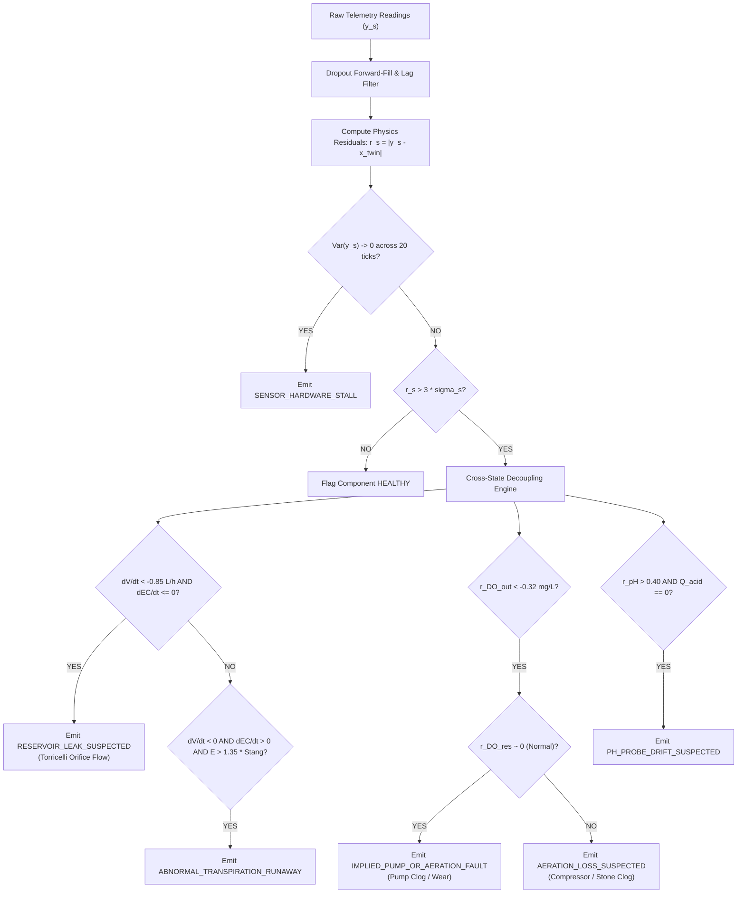

# Model 5: Multi-Fault Isolation & Physics-Guided Residual Anomaly Detector

**Document Version:** 1.0.0  
**Target Module:** Machine Learning Controller & Diagnostic Layer  
**System Layer:** Diagnostic Supervisor / Fault Detection & Isolation (FDI) Engine  

---

## 1. Why We Use It
Modern hydroponic facilities fail through multiple overlapping physical and electrical mechanisms. Relying on raw threshold alerts generates constant false alarms:
* A falling reservoir level could indicate **healthy crop transpiration** or a **structural leak**.
* A low DO reading could mean a **failed circulation pump**, an **air stone clog**, or a **biofouled sensor**.
* A drifting pH could indicate a **failing glass probe** or real **nitrate uptake alkalinization**.

Model 5 eliminates false alarms by computing **physics-guided innovation residuals**:
$$r_s(t) = |y_{s,\text{observed}}(t) - \hat{x}_{s,\text{twin}}(t)|$$
It then evaluates **decoupling rules** (e.g., Torricelli solute invariance and spatial DO cross-checks) to classify root causes within 18 simulated hours and dispatches component-tagged diagnostic alerts (`POST /alerts`).

---

## 2. How It Works (Fault Signatures & Disambiguation Logic)



### The 6 Target Physical Fault Signatures

| Fault Kind | Component ID | Key Mechanism | Disambiguation Rule |
| :--- | :--- | :--- | :--- |
| **`pump_degradation`** | `pump-1` | Gully outlet DO drops sharply ($r_{\text{DO}} < -0.32\text{ mg L}^{-1}$). | **Spatial DO Decoupling:** Channel DO collapses while reservoir DO remains saturated. |
| **`aeration_loss`** | `aer-1` | Sintered ceramic air stone clogs or air compressor fails. | **Parallel Drop:** Both reservoir DO and channel DO collapse ($< 4.0\text{ mg L}^{-1}$). |
| **`heat_wave`** | `enc-1` | Enclosure air temperature spikes ($> +3.5^\circ\text{C}$). | Air temperature and VPD elevate simultaneously; water uptake increases. |
| **`probe_drift`** | `sen-ph-1` | Biofouling or reference junction depletion. | **Chemical Speciation Check:** Measured pH diverges from speciation without actuator action. |
| **`nutrient_imbalance`** | `stock-a` | Stock A concentration deviation. | Step change in EC immediately following a Stock A dose ($r_{\text{EC}} > +0.10\text{ dS m}^{-1}$). |
| **`reservoir_leak`** | `res-1` | Physical crack in tank or return line. | **Torricelli Solute Invariance:** Level drops ($\dot{V} < -0.85\text{ L h}^{-1}$) while $\dot{\text{EC}}_{25} \le 0$. |

---

## 3. Operational Model Flow
1. **Packet Cleaning:** Scans input arrays for `null` dropouts and applies zero-order hold (forward-fill) interpolation.
2. **Residual Generation:** Subtracts Model 1–4 analytical twin predictions from raw telemetry.
3. **Variance Check:** Checks for frozen ADC converter outputs ($\text{Var}(y_s) \to 0$).
4. **Decoupling Logic:** Applies the decision tree to separate leaks from transpiration, and pump stalls from aeration loss.
5. **Alert Assembly:** Packages confirmed faults into component-tagged payloads and issues `POST /api/v1/simulations/{id}/alerts`.

---

## 4. Input & Output Schemas

### Input Schema (`model5_input.json`)
```json
{
  "simulation_id": "sim-894a0f04-f37d-4889",
  "sim_time_sec": 86400.0,
  "observed_telemetry": [
    {"kind": "V_res", "sensor_id": "sen-vres-1", "value": 78.4, "unit": "L"},
    {"kind": "EC", "sensor_id": "sen-ec-1", "value": 2.01, "unit": "dS/m"},
    {"kind": "pH", "sensor_id": "sen-ph-1", "value": 5.98, "unit": "pH"},
    {"kind": "DO", "sensor_id": "sen-do-1", "value": 4.95, "unit": "mg/L"},
    {"kind": "T_air", "sensor_id": "sen-tair-1", "value": 24.5, "unit": "C"}
  ],
  "twin_reference_states": {
    "v_res_l": 88.2,
    "ec25_ds_m": 2.02,
    "ph": 5.95,
    "c_do_ch_out_mg_l": 7.65,
    "c_do_res_mg_l": 8.12,
    "t_air_c": 24.1
  },
  "actuator_context": {
    "pump_throttle": 1.0,
    "last_chemical_dose_sec": 72000.0,
    "dose_acid_commanded_ml": 0.0
  }
}
```

### Output Schema: Emitted Alert Payload (`POST /alerts`)
```json
{
  "component_id": "pump-1",
  "severity": "critical",
  "code": "IMPLIED_PUMP_OR_AERATION_FAULT",
  "message": "Outlet DO dropped to 4.95 mg/L (expected 7.65 mg/L) while reservoir DO remains saturated at 8.12 mg/L. Pump degradation or root obstruction diagnosed."
}
```

### Internal Sensor Health Status Summary (`model5_health_matrix.json`)
```json
{
  "evaluation_time_sec": 86400.0,
  "overall_system_status": "DEGRADED",
  "sensor_health": {
    "sen-vres-1": "HEALTHY",
    "sen-ec-1": "HEALTHY",
    "sen-ph-1": "HEALTHY",
    "sen-do-1": "DEGRADED",
    "sen-tair-1": "HEALTHY"
  },
  "active_diagnosed_faults": [
    "IMPLIED_PUMP_OR_AERATION_FAULT"
  ]
}
```