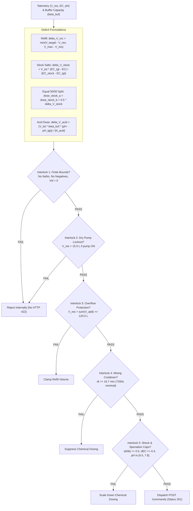

# Model 6: Autonomous Fertigation Dosing & PLC Safety Guardian Engine

**Document Version:** 1.0.0  
**Target Module:** Closed-Loop Control & Actuation Verification  
**System Layer:** Supervisory Controller / Safe Actuation Dispatcher  

---

## 1. Why We Use It
Autonomous closed-loop fertigation systems face two opposing challenges:
1. **Biological Demands:** Crop fresh weight is optimized when electrical conductivity remains tight ($\approx 2.0\text{ dS m}^{-1}$), pH is stable ($5.8 - 6.2$), and water losses from transpiration are promptly restored.
2. **Hardware Constraints & Chemical Shock:** Large chemical injections create localized acid shock, which can precipitate fertilizer salts or scorch roots. Furthermore, running pumps dry or overfilling reservoirs leads to equipment burnout or flooding.

Model 6 solves this by calculating exact water, fertilizer, and acid doses based on system deficits and buffer capacity, then passing every command through **5 deterministic zero-bypass PLC safety interlocks**. This ensures a **0.0% command rejection rate (`HTTP 422`)** from the Go Core Backend.

---

## 2. How It Works (Dosing Formulations & The 5 PLC Interlocks)



### 2.1 Closed-Loop Dosing Math
1. **Freshwater Refill Volume:**
   $$\Delta V_{\text{src}} = \min\left(V_{\text{target}} - V_{\text{res}}, \, V_{\text{res,max}} - V_{\text{res}}\right)$$
2. **Balanced Fertilizer Stock Dosing (Stock A & B):**
   $$\Delta V_{\text{dose,stock}} = V_{\text{tot}} \left(\frac{\text{EC}_{\text{target}} - \text{EC}_{25}}{\text{EC}_{\text{stock}} - \text{EC}_{\text{target}}}\right) \times 10^3 \quad [\text{mL}]$$
   Divided equally into Stock A and Stock B ($50\% / 50\%$) to maintain nutrient balance and prevent concentrated precipitation:
   $$\Delta V_{\text{dose,A}} = \Delta V_{\text{dose,B}} = 0.5 \cdot \Delta V_{\text{dose,stock}}$$
3. **Acid Neutralization Dosing:**
   $$\Delta V_{\text{dose,acid}} = \frac{V_{\text{tot}} \cdot \beta_{\text{buf}} \cdot (\text{pH} - \text{pH}_{\text{target}})}{|N_{\text{acid}}|} \times 10^3 \quad [\text{mL}]$$

### 2.2 The 5 Zero-Bypass PLC Safety Interlocks

| Rule | Interlock Name | Formal Go Backend Validation Rule | Local Mitigation Strategy |
| :---: | :--- | :--- | :--- |
| **Rule 1** | **Finite Bounds** | $\forall V_k \ge 0$, finite, non-NaN; throttle $\in [0.0, 1.0]$. | Reject invalid commands locally. |
| **Rule 2** | **Dry Pump Lockout** | If $V_{\text{res}} \le 15.0\text{ L}$, circulation pump throttle $> 0$ is rejected. | Keep pump disabled until water is replenished. |
| **Rule 3** | **Tank Overflow Cap** | $V_{\text{res}} + \Delta V_{\text{src}} + \sum \Delta V_{\text{chem}} \le 120.0\text{ L}$. | Clamp refill water volume $\Delta V_{\text{src}}$ so total remains $\le 120.0\text{ L}$. |
| **Rule 4** | **Mixing Cooldown** | Time since last dose $\Delta t \ge 0.5 \cdot \frac{V_{\text{res}}}{Q_{\text{pump}}} \approx 16.7\text{ min}$. | Enforce a conservative cooldown (e.g., 2 hours). |
| **Rule 5** | **Chemical Shock Cap** | $|\Delta [\text{Alk}]| \le 0.50\text{ meq L}^{-1}$, $\Delta \text{EC} \le 0.40\text{ dS m}^{-1}$; $\text{pH}_{\text{eq}} \in [4.5, 7.8]$. | Clamp doses to the safety envelope. |

---

## 3. Operational Model Flow
1. **Deficit Determination:** Evaluates current telemetry ($V_{\text{res}}, \text{EC}, \text{pH}$) against agronomic setpoints.
2. **Buffer Integration:** Queries Model 3 for buffer capacity $\beta_{\text{buf}}$ to compute acid requirements.
3. **Internal Safety Dry Run:** Passes the proposed dosing vector through Rules 1 through 5.
4. **Command Generation:** If all interlocks pass, constructs the payload and submits it via `POST /api/v1/simulations/{id}/commands`.
5. **Actuator Audit:** Tracks post-dosing response over time. If dosing fails to change water conditions as expected, flags the pump as `FAILED_PUMP_UNRESPONSIVE`.

---

## 4. Input & Output Schemas

### Input Schema (`model6_input.json`)
```json
{
  "simulation_id": "sim-894a0f04-f37d-4889",
  "sim_time_sec": 86400.0,
  "current_telemetry": {
    "v_res_l": 88.5,
    "ec25_ds_m": 1.78,
    "ph": 6.35,
    "water_temp_c": 22.0
  },
  "agronomic_targets": {
    "v_target_l": 100.0,
    "ec_target_ds_m": 2.00,
    "ph_target": 6.00
  },
  "chemical_context": {
    "buffer_capacity_meq_l_ph": 0.384,
    "stock_ec_ds_m": 50.0,
    "acid_normality_n": 1.0,
    "last_chemical_dose_sec": 79200.0
  }
}
```

### Output Schema: Validated Actuation Command (`POST /commands`)
```json
{
  "target_component_id": "res-1",
  "action": "dose",
  "refill_water_l": 11.5,
  "dose_stock_a_ml": 8.0,
  "dose_stock_b_ml": 8.0,
  "dose_acid_ml": 4.5,
  "reason": "Replenish tank to 100L setpoint, adjust EC to 2.0 dS/m, and counter nitrate alkalinization."
}
```

### Backend Acceptance Response (`201 Created`)
```json
{
  "id": "cmd-781920",
  "simulation_id": "sim-894a0f04-f37d-4889",
  "sim_time_sec": 86400.0,
  "target_component_id": "res-1",
  "action": "dose",
  "status": "accepted",
  "created_at": "2026-11-08T14:20:00Z"
}
```