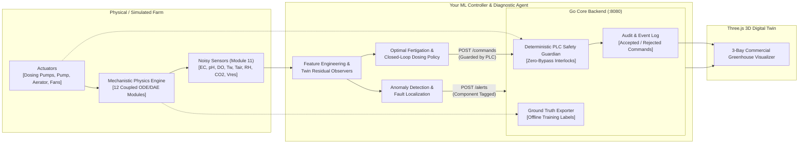
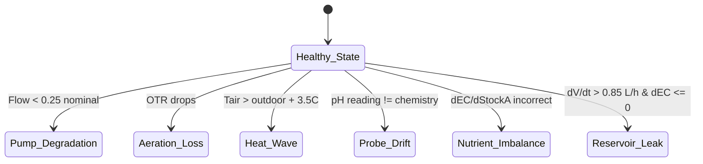
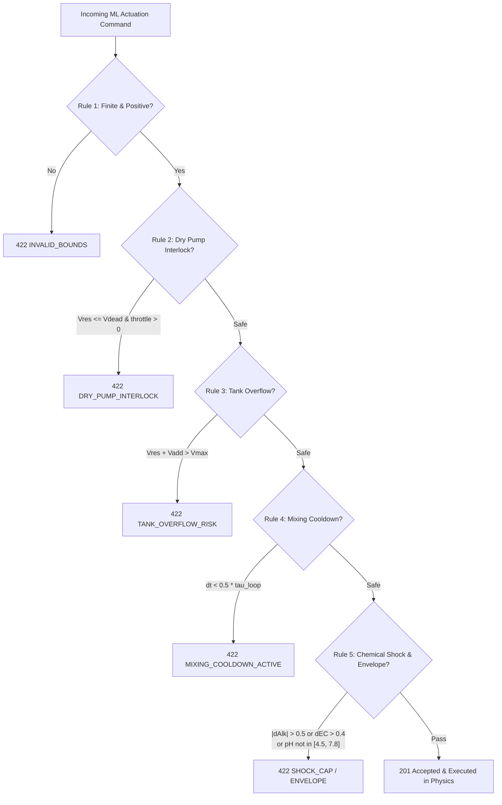

# HydroTwin: Machine Learning Engineer & Controller Handbook
**Configurable Autonomous NFT Hydroponic Digital Twin (Sensor X Challenge)**  
*Document Version: 1.0.0 · Target Backend: Go Hydro Twin Engine (`:8080`)*

---

## 1. Mission Overview & System Architecture

You are building the **Machine Learning Controller and Diagnostic Agent** for an autonomous, recirculating **Nutrient Film Technique (NFT) commercial lettuce (*Lactuca sativa* L.)** facility.

### Architecture Overview



### The Three Mandates of the ML Teammate:
1. **Predictive Anomaly Detection & Fault Localization:** Observe streaming noisy sensor telemetry, detect 6 physical fault perturbations early ($\le 48\text{ hours}$), and dispatch component-tagged diagnostic alerts (`POST /alerts`).
2. **Autonomous Closed-Loop Fertigation Control:** Maintain optimal nutrient balance ($\text{EC} \approx 2.0\text{ dS/m}$, $\text{pH} \in [5.8, 6.2]$, dissolved oxygen $> 6.5\text{ mg/L}$, water volume replenished) to maximize fresh shoot biomass harvest weight.
3. **Zero Safety Violations:** Formulate actuation commands that strictly satisfy the deterministic Go PLC Safety Guardian rules. Any rejected command (`HTTP 422`) penalizes controller reliability.

---

## 2. Training, Validation & Benchmark Datasets

Your model has access to both **empirical commercial greenhouse datasets** from Egypt/NASA and a **high-throughput deterministic synthetic physics engine**.

### 2.1. Real Alexandria AASTMT Commercial Datasets
Located in `testdata/real_datasets/hydrogrownet_egypt/`:
* **Validation Baseline:** Calibrated against 3 full commercial cohort trials ($N = 72$ Batavia heads each) grown under Mediterranean coastal greenhouse conditions at AASTMT (Abu Qir, Alexandria, Egypt: $31.2001^\circ\text{N}, 29.9187^\circ\text{E}$, elevation $7\text{ m}$).

| Experiment | Season & Dates | Day of Year (Start) | Source Water Profile | Target EC | Target pH | Real Harvest Fresh Weight ($N=72$) | Target Yield Benchmark |
| :--- | :--- | :---: | :--- | :---: | :---: | :---: | :---: |
| **EXP.1** | Spring (Mar 9 → Apr 8, 2024) | `DOY 69` | `egypt_nile_fresh` (Alk: 0.42) | $2.00\text{ dS/m}$ | $5.95$ | **$201.9 \pm 29.2\text{ g}$** | **$> 144.0\text{ g}$** |
| **EXP.2** | Optimal (Apr 15 → May 15, 2024) | `DOY 106` | `egypt_nile_fresh` (Alk: 0.65) | $2.00\text{ dS/m}$ | $6.30$ | **$290.8 \pm 40.7\text{ g}$** | **$> 209.0\text{ g}$** |
| **EXP.3** | Summer Heat (May 19 → Jun 18, 2024) | `DOY 140` | `egypt_delta_brackish` (Alk: 0.85) | $2.20\text{ dS/m}$ | $6.10$ | **$252.2 \pm 46.5\text{ g}$** | **$> 159.0\text{ g}$** |

#### Real Dataset Files on Disk:
* `testdata/real_datasets/hydrogrownet_egypt/exp1_farm.json`: Full validated farm spec for Spring.
* `testdata/real_datasets/hydrogrownet_egypt/exp2_farm.json`: Full validated farm spec for Optimal.
* `testdata/real_datasets/hydrogrownet_egypt/exp3_farm.json`: Full validated farm spec for Summer.
* `testdata/real_datasets/hydrogrownet_egypt/exp{1,2,3}_daily_water_quality.csv`: Measured daily time-series:
  ```csv
  day,EC_dSm,pH,T_w_C
  1,1.623,6.933,25.13
  2,1.657,6.267,27.38
  ...
  ```
* `testdata/real_datasets/hydrogrownet_egypt/EXP.{1,2,3}. Environmental Conditions and Plant Measurements.xlsx`: Raw microclimate and biometric destruction measurements.

### 2.2. Supplemental Benchmark Datasets
* `testdata/real_datasets/nasa_osd723_nft_lettuce/`: NASA GeneLab OSD-723 recirculating NFT lettuce dataset.
* `testdata/real_datasets/aerogarden_32day_lettuce_sensors.tsv`: High-frequency sensor log (EC, pH, temperature, water level).
* `testdata/real_datasets/kang_2026_do_lettuce/`: Empirical root-zone dissolved oxygen uptake and respiration kinetics.
* `testdata/real_datasets/gallardo_lettuce_transpiration.csv`: Daily solar radiation to transpiration ratio.

### 2.3. Synthetic Dataset Generation via Physics Engine
You can generate unlimited synthetic training runs with arbitrary fault combinations and seeds:
* Fast-forward $30\text{ days}$ ($8{,}640$ ticks at $\Delta t = 300\text{ s}$) in **$< 50\text{ ms}$ CPU time** via `POST /api/v1/simulations/{id}/advance`.
* Noisy observable telemetry is acquired via `GET /readings`.
* True underlying ground truth ($V_{\text{res}}$, 10 ion concentrations $C_i$, true biomass, unobservable physical states) is exported via `GET /ground-truth` for supervised training labels.

---

## 3. The 6 Target Physical Faults (What to Detect)

The digital twin includes physical fault models from Module 12. Your ML model must classify each fault and tag the exact component ID.



### Fault Specification Matrix

| Fault Code | Target Component | Physical Mechanism | Injected Intensity Range | Observable Sensor Signature | Disambiguation Key |
| :--- | :--- | :--- | :---: | :--- | :--- |
| `pump_degradation` | `pump-1` | Impeller clogging or mechanical wear reducing rated flow $Q_{\text{pump}}$. | $[0.10, 0.95]$ (fractional flow loss) | **Gully outlet DO drops sharply** ($r_{\text{DO}} < -0.32\text{ mg/L}$); reservoir DO remains high. | Outlet DO is low while reservoir DO is normal. Channel residence time increases. |
| `aeration_loss` | `aer-1` | Sintered ceramic air stone clogging or air compressor failure. | $[0.20, 1.00]$ (fractional aeration loss) | **Both reservoir DO and gully DO plummet** ($< 4.0\text{ mg/L}$ across the entire loop). | Reservoir DO drops in lockstep with channel DO. Pump flow remains normal ($3.0\text{ L/min}$). |
| `heat_wave` | `enc-1` | Ambient summer heat spike or ventilation fan malfunction. | $+3.0^\circ\text{C}$ to $+8.0^\circ\text{C}$ above outdoor ambient | Canopy $T_{\text{air}}$ rises above seasonal diurnal model ($r_{T\text{air}} > +3.5^\circ\text{C}$); transpiration accelerates. | Air temperature and VPD jump together; water consumption spikes. |
| `probe_drift` | `sen-ph-1` | Reference junction degradation or biofouling on pH glass bulb. | $+0.01$ to $+0.08\text{ pH/hr}$ drift rate | Sensor reads alkaline drift while stoichiometric twin chemistry predicts neutral/acidic. | Measured pH diverges from twin buffer speciation after dosing acid. |
| `nutrient_imbalance` | `stock-a` | Mis-mixed Stock A tank (wrong mass of $\text{Ca(NO}_3)_2$ dissolved). | $-0.50$ to $+1.00$ relative concentration error | Jump in EC following Stock A dose does not match stoichiometric expectation ($r_{\text{EC}} > +0.10\text{ dS/m}$). | Anomaly manifests immediately following a Stock A dosing actuation. |
| `reservoir_leak` | `res-1` | Physical crack in reservoir tub or loose return drainage fitting. | Orifice area yielding loss $> 0.85\text{ L/hr}$ | Tank volume drops rapidly ($\dot{V}_{\text{res}} > 0.85\text{ L/hr}$), but **EC does NOT concentrate** ($\dot{\text{EC}} \le 0$). | **Leak vs. Transpiration:** Transpiration evaporates pure $\text{H}_2\text{O}$ and concentrates salts ($\dot{\text{EC}} > 0$); a physical leak loses both water and ions together ($\dot{\text{EC}} \le 0$). |

---

## 4. Sensor Observer Layer & Feature Engineering

The physical environment is observed through noisy sensors (Module 11).

### 4.1. Sensor Catalog & Error Characteristics

| Sensor Kind | Typical Sensor ID | Target Component | Measurement Unit | Accuracy Noise ($\sigma$) | First-Order Lag ($\tau_{\text{lag}}$) | Systematic Drift Rate | Dropout Probability ($p_{\text{drop}}$) |
| :--- | :--- | :--- | :---: | :---: | :---: | :---: | :---: |
| `EC` | `sen-ec-1` | `res-1` | $\text{dS/m}$ | $\pm 0.02$ | $15\text{ s}$ | $\pm 0.005\text{ dS/m/month}$ | $0.005$ |
| `pH` | `sen-ph-1` | `res-1` | $\text{pH}$ | $\pm 0.02$ | $30\text{ s}$ | $\pm 0.02\text{ pH/week}$ | $0.005$ |
| `T_w` | `sen-tw-1` | `res-1` | $^\circ\text{C}$ | $\pm 0.10$ | $45\text{ s}$ | None | $0.002$ |
| `V_res` | `sen-vres-1` | `res-1` | $\text{L}$ | $\pm 0.30$ | $5\text{ s}$ | None | $0.005$ |
| `DO` | `sen-do-1` | `ch-1` | $\text{mg/L}$ | $\pm 0.08$ | $20\text{ s}$ | $\pm 0.05\text{ mg/L/week}$ | $0.005$ |
| `T_air` | `sen-tair-1` | `enc-1` | $^\circ\text{C}$ | $\pm 0.15$ | $60\text{ s}$ | None | $0.002$ |
| `RH` | `sen-rh-1` | `enc-1` | $\%$ | $\pm 1.00$ | $60\text{ s}$ | None | $0.002$ |
| `CO2` | `sen-co2-1` | `enc-1` | $\text{ppm}$ | $\pm 8.00$ | $60\text{ s}$ | None | $0.005$ |

> [!WARNING]
> **Packet Dropouts:** Sensor readings may return `value: null` when a Bernoulli packet loss occurs. Your feature pipeline must forward-fill or drop missing timestamps.

---

### 4.2. Recommended Feature Extraction & Residual Observers

Rather than training purely on raw sensor values, the highest performance is achieved by computing **physics-guided residuals** against a reference analytical digital twin:
$$r_k(t) = y_{k,\text{observed}}(t) - \hat{y}_{k,\text{twin}}(t)$$

#### 1. Theoretical Dissolved Oxygen Saturation (Benson-Krause Model)
Compute expected saturation $C^*_{\text{DO}}(T_w, \text{EC}, z)$ at elevation $z = 7\text{ m}$:
```python
import numpy as np

def benson_krause_do_sat(tw_c: float, ec_dsm: float = 2.0, z_elev_m: float = 7.0) -> float:
    tk = tw_c + 273.15
    ln_c0 = -139.34411 + 1.575701e5/tk - 6.642308e7/(tk**2) + 1.243800e10/(tk**3) - 8.621949e11/(tk**4)
    c0 = np.exp(ln_c0)
    salinity = 0.55 * max(0.0, ec_dsm)
    f_s = np.exp(-salinity * (0.017674 - 10.754/tk + 2140.7/(tk**2)))
    p_atm = (1.0 - 2.25577e-5 * z_elev_m) ** 5.25588
    u_vap = np.exp(11.8571 - 3840.7/tk - 216961.0/(tk**2))
    theta0 = 0.000975 - 1.426e-5 * tw_c + 6.436e-8 * (tw_c**2)
    f_p = (p_atm * (1.0 - u_vap/p_atm) * (1.0 - theta0 * p_atm)) / ((1.0 - u_vap) * (1.0 - theta0))
    return float(c0 * f_s * f_p)
```

#### 2. Normal Root Oxygen Drop in NFT Channels
In a healthy working channel, outlet DO is lower than inlet DO due to root respiration:
$$\Delta \text{DO}_{\text{channel}}(t) = 0.10 + 0.45 \cdot \min\left(1.0, \frac{\text{day}}{28.0}\right)\text{ mg/L}$$
$$\hat{y}_{\text{DO}}(t) = C^*_{\text{DO}} \cdot 0.985 - \Delta \text{DO}_{\text{channel}}(t)$$
* If residual $r_{\text{DO}} = y_{\text{DO}} - \hat{y}_{\text{DO}} < -0.32\text{ mg/L}$ persists for 2 consecutive ticks, raise `IMPLIED_PUMP_OR_AERATION_FAULT`.

#### 3. Tank Rate of Loss ($\dot{V}_{\text{res}}$)
* Normal lettuce evapotranspiration rate: $0.05 \text{ to } 0.22\text{ L/hr}$.
* If $-\frac{d V_{\text{res}}}{dt} > 0.85\text{ L/hr}$ while $\frac{d\text{EC}}{dt} \le 0$, trigger `RESERVOIR_LEAK_SUSPECTED`.

---

## 5. API Reference & Exact Request/Response Payloads

### 5.1. Authentication & Base URLs
* **Backend Port:** `http://localhost:8080` (Direct Go REST service)
* **Vite Proxy Port:** `http://localhost:5173` (Proxies `/api` and `/healthz` to `:8080`)
* **Authentication:** Dosing commands and alert posting require the ML bearer token:
  ```http
  Authorization: Bearer <HYDRO_ML_API_KEY>
  ```
  *(Default local dev key configured in `.env.example`: `test-ml-secret-key-12345`)*

---

### 5.2. Simulation Lifecycle & Clock Control

#### Create Simulation
* **`POST /api/v1/simulations`**
* **Headers:** `Content-Type: application/json`
* **Request Payload:**
  ```json
  {
    "farm_id": "b0ed0031-8f05-412c-91da-87639aa00d39",
    "seed": 42,
    "step_seconds": 300,
    "initial_mode": "paused",
    "speed_multiplier": 60.0
  }
  ```
* **Response `201 Created`:**
  ```json
  {
    "id": "sim-894a0f04-f37d-4889",
    "farm_id": "b0ed0031-8f05-412c-91da-87639aa00d39",
    "seed": 42,
    "step_seconds": 300,
    "mode": "paused",
    "speed_multiplier": 60,
    "tick_index": 0,
    "sim_time_sec": 0,
    "sim_days": 0,
    "active_faults": [],
    "created_at": "2026-11-08T14:00:00Z"
  }
  ```

#### Fast-Forward Simulation by $N$ Steps
* **`POST /api/v1/simulations/{id}/advance`**
* **Request Payload:**
  ```json
  {
    "steps": 12
  }
  ```
  *(12 steps $\times 300\text{ s} = 3{,}600\text{ s} = 1\text{ simulated hour}$. 288 steps $= 1\text{ full simulated day}$. Max: 20,000 steps).*
* **Response `200 OK`:** Returns updated simulation status and latest sensor snapshot.

---

### 5.3. Telemetry & Sensor Observations

#### Get Noisy Sensor Readings
* **`GET /api/v1/simulations/{id}/readings?limit=200`**
* **Response `200 OK`:**
  ```json
  [
    {
      "tick_index": 12,
      "sim_time_sec": 3600.0,
      "sensor_id": "sen-ec-1",
      "component_id": "res-1",
      "kind": "EC",
      "value": 2.014,
      "unit": "dS/m"
    },
    {
      "tick_index": 12,
      "sim_time_sec": 3600.0,
      "sensor_id": "sen-ph-1",
      "component_id": "res-1",
      "kind": "pH",
      "value": 5.968,
      "unit": "pH"
    },
    {
      "tick_index": 12,
      "sim_time_sec": 3600.0,
      "sensor_id": "sen-do-1",
      "component_id": "ch-1",
      "kind": "DO",
      "value": 7.742,
      "unit": "mg/L"
    },
    {
      "tick_index": 12,
      "sim_time_sec": 3600.0,
      "sensor_id": "sen-vres-1",
      "component_id": "res-1",
      "kind": "V_res",
      "value": 99.82,
      "unit": "L"
    }
  ]
  ```

#### Export True Ground Truth (Offline Training / Labels Only)
* **`GET /api/v1/simulations/{id}/ground-truth`**
* **Response `200 OK`:**
  ```json
  {
    "sim_time_sec": 3600.0,
    "tick_index": 12,
    "v_res_l": 99.85,
    "v_ch_tot_l": 1.48,
    "t_air_c": 23.48,
    "rh_pct": 62.1,
    "co2_ppm": 412.0,
    "t_res_c": 22.14,
    "ph": 5.952,
    "ec25_ds_m": 2.008,
    "c_do_res_mg_l": 8.12,
    "c_do_ch_out_mg_l": 7.78,
    "shoot_fw_g_per_plant": 5.24,
    "shoot_dw_g_per_plant": 0.262,
    "root_dw_g_per_plant": 0.052,
    "stress_factor": 1.0,
    "ions_mmol_l": {
      "NO3": 14.10,
      "P_tot": 1.92,
      "K": 7.68,
      "Ca": 3.84,
      "Mg": 1.28,
      "SO4": 1.28
    },
    "active_faults": []
  }
  ```

---

### 5.4. Fault Injection (Testing Your Detector)

* **`POST /api/v1/simulations/{id}/faults`**
* **Headers:** `Content-Type: application/json`
* **Injecting a Pump Clog Payload:**
  ```json
  {
    "kind": "pump_degradation",
    "target_component_id": "pump-1",
    "intensity": 0.75,
    "trigger_at_sim_sec": 0
  }
  ```
* **Injecting a Tank Leak Payload:**
  ```json
  {
    "kind": "reservoir_leak",
    "target_component_id": "res-1",
    "intensity": 0.0000025,
    "trigger_at_sim_sec": 0
  }
  ```
* **Clearing a Fault Payload:**
  ```json
  {
    "kind": "pump_degradation",
    "target_component_id": "pump-1",
    "intensity": 0.0,
    "clear": true
  }
  ```

---

### 5.5. Raising Diagnostic Alerts (`POST /alerts`)

When your ML model detects an anomaly, publish an alert. This immediately updates the frontend Three.js digital twin:

* **`POST /api/v1/simulations/{id}/alerts`**
* **Headers:**
  ```http
  Authorization: Bearer <HYDRO_ML_API_KEY>
  Content-Type: application/json
  ```
* **Payload Examples:**
  ```json
  {
    "component_id": "pump-1",
    "severity": "critical",
    "code": "IMPLIED_PUMP_OR_AERATION_FAULT",
    "message": "Outlet DO dropped to 5.1 mg/L (expected 7.8 mg/L). Mechanical pump degradation or root channel blockage detected."
  }
  ```
  ```json
  {
    "component_id": "res-1",
    "severity": "critical",
    "code": "RESERVOIR_LEAK_SUSPECTED",
    "message": "Tank level dropping at 1.4 L/hr with no EC concentration. Orifice leak suspected."
  }
  ```
  ```json
  {
    "component_id": "sen-ph-1",
    "severity": "warning",
    "code": "PH_PROBE_DRIFT_SUSPECTED",
    "message": "Probe reading 6.75 pH while chemical equilibrium predicts 5.92 pH (+0.83 residual). Switching to virtual twin pH estimator."
  }
  ```
* **Response `201 Created`:**
  ```json
  {
    "id": "alt-382941",
    "simulation_id": "sim-894a0f04-f37d-4889",
    "sim_time_sec": 86400.0,
    "component_id": "pump-1",
    "severity": "critical",
    "code": "IMPLIED_PUMP_OR_AERATION_FAULT",
    "message": "Outlet DO dropped to 5.1 mg/L...",
    "created_at": "2026-11-08T14:15:00Z"
  }
  ```

---

### 5.6. Submitting Actuation Commands (`POST /commands`)

All physical mutations pass through the deterministic Go PLC Safety Guardian:

* **`POST /api/v1/simulations/{id}/commands`**
* **Headers:**
  ```http
  Authorization: Bearer <HYDRO_ML_API_KEY>
  Content-Type: application/json
  ```

#### Example 1: Balanced Nutrient Dose + Water Top-Up
```json
{
  "target_component_id": "res-1",
  "action": "dose",
  "refill_water_l": 5.0,
  "dose_stock_a_ml": 12.0,
  "dose_stock_b_ml": 12.0,
  "dose_acid_ml": 8.0,
  "reason": "Top up evapotranspiration loss, restore EC to 2.0 dS/m, and counter nitrate alkalinization."
}
```

#### Example 2: Actuator Speed Modulation
```json
{
  "target_component_id": "pump-1",
  "action": "set_pump_throttle",
  "throttle": 0.85,
  "reason": "Reduce circulation speed during high root-zone dissolved oxygen saturation."
}
```

* **Accepted Response (`201 Created`):**
  ```json
  {
    "id": "cmd-781920",
    "simulation_id": "sim-894a0f04-f37d-4889",
    "sim_time_sec": 86400.0,
    "target_component_id": "res-1",
    "action": "dose",
    "status": "accepted",
    "created_at": "2026-11-08T14:20:00Z"
  }
  ```

* **Rejected Response (`422 Unprocessable Entity`):**
  ```json
  {
    "id": "cmd-781921",
    "simulation_id": "sim-894a0f04-f37d-4889",
    "status": "rejected_safety",
    "rejection_code": "SINGLE_DOSE_CAP_EXCEEDED",
    "rejection_message": "single acid/base dose shifts reservoir alkalinity by 0.68 meq/L, exceeding safety cap of 0.50 meq/L"
  }
  ```

---

## 6. The Go PLC Safety Guardian: Zero-Bypass Interlocks

Before any actuation reaches the physical equations, `internal/safety/guardian.go` executes five deterministic checks. If any check fails, the command is **rejected with HTTP 422** and logged in the permanent audit trail.



### The 5 Interlocks Explained:

1. **Rule 1: Finite Bounds (`INVALID_BOUNDS`)**
   * All dosing volumes (`dose_stock_a_ml`, `dose_stock_b_ml`, `dose_acid_ml`, `dose_base_ml`, `refill_water_l`) must be non-negative and finite (no `NaN`, `Inf`, or $< 0$).
   * Any `throttle` must be $\in [0.0, 1.0]$.
   * Total added volume must be $> 0$.

2. **Rule 2: Dry Pump Protection (`DRY_PUMP_INTERLOCK`)**
   * If reservoir water volume $V_{\text{res}} \le V_{\text{res,dead}}$ ($15.0\text{ L}$ on a $100\text{ L}$ tank), engaging the circulation pump (`throttle > 0`) is strictly forbidden to prevent pump motor burnout.

3. **Rule 3: Tank Overflow Interlock (`TANK_OVERFLOW_RISK`)**
   * The sum of current volume + all chemical doses + refill water must not exceed $V_{\text{res,max}}$:
     $$V_{\text{res}} + V_{\text{refill}} + V_{\text{chem}} \le V_{\text{res,max}} \quad (120.0\text{ L})$$

4. **Rule 4: Hydraulic Mixing Cooldown (`MIXING_COOLDOWN_ACTIVE`)**
   * Chemical reactions require complete hydraulic turnover before another chemical dose is introduced.
   * Cooldown period:
     $$\tau_{\text{cooldown}} = \max\left(\Delta t, 0.5 \cdot \tau_{\text{loop}}\right) = \max\left(300\text{ s}, 0.5 \cdot \frac{V_{\text{res}}}{Q_{\text{pump}}}\right)$$
   * For $V_{\text{res}} = 100\text{ L}$ and $Q_{\text{pump}} = 3.0\text{ L/min} = 0.05\text{ L/s}$, $\tau_{\text{loop}} = 2{,}000\text{ s} \implies \tau_{\text{cooldown}} = 1{,}000\text{ s} \approx 16.7\text{ min}$.
   * **Rule of thumb:** Do not submit chemical doses more frequently than **once every 2 to 3 simulated hours**.

5. **Rule 5: Chemical Shock Cap & Speciation Envelope (`SINGLE_DOSE_CAP_EXCEEDED`, `PREDICTED_PH_OUT_OF_ENVELOPE`)**
   * **Single Acid/Base Shock Cap:** A single dose must not shift total alkalinity by more than $0.50\text{ meq/L}$:
     $$|\Delta \text{Alk}| \le 0.50\text{ meq/L}$$
   * **Single EC Jump Cap:** A single nutrient dose must not increase $\text{EC}_{25}$ by more than $+0.40\text{ dS/m}$:
     $$\Delta \text{EC}_{25} \le +0.40\text{ dS/m}$$
   * **Post-Mix Speciation Dry-Run:** The Go guardian runs a simulated equilibrium proton electroneutrality speciation. If predicted post-mix $\text{pH} \notin [4.50, 7.80]$ or $\text{EC}_{25} > 4.00\text{ dS/m}$, the command is rejected immediately.

---

## 7. Performance & Benchmark Targets

To guarantee contest victory, your ML controller will be graded against:

| Evaluation Metric | Minimum Target | Optimal Target |
| :--- | :---: | :---: |
| **Harvest Fresh Weight (EXP.1 Spring)** | $> 144.0\text{ g}$ | $201.9 \pm 29.2\text{ g}$ |
| **Harvest Fresh Weight (EXP.2 Optimal)** | $> 209.0\text{ g}$ | $290.8 \pm 40.7\text{ g}$ |
| **Harvest Fresh Weight (EXP.3 Summer)** | $> 159.0\text{ g}$ | $252.2 \pm 46.5\text{ g}$ |
| **Fault Detection Latency (All 6 Faults)** | $< 48\text{ simulation hours}$ | $< 18\text{ simulation hours}$ |
| **False Positive Alarm Rate (Healthy Run)** | $0\text{ false alerts}$ | $0\text{ false alerts}$ |
| **PLC Guardian Command Rejection Rate** | $< 1.0\%$ | **$0.0\%$ (Zero 422 errors)** |

---

## 8. Python Starter Kit (`ml_controller.py`)

Here is a ready-to-run, standalone Python controller implementing the full closed-loop pipeline:

```python
#!/usr/bin/env python3
"""
HydroTwin Autonomous ML Controller & Diagnostic Agent
Compatible with Go Hydro Backend (:8080)
"""

import os
import sys
import time
import math
import requests
from typing import Dict, Any, List, Optional

BASE_URL = os.environ.get("HYDRO_API_URL", "http://localhost:8080")
ML_API_KEY = os.environ.get("HYDRO_ML_API_KEY", "test-ml-secret-key-12345")
HEADERS = {
    "Authorization": f"Bearer {ML_API_KEY}",
    "Content-Type": "application/json"
}

class HydroTwinClient:
    def __init__(self, base_url: str = BASE_URL):
        self.base_url = base_url.rstrip("/")

    def create_simulation(self, farm_id: str, seed: int = 42) -> str:
        payload = {"farm_id": farm_id, "seed": seed, "step_seconds": 300, "initial_mode": "paused"}
        res = requests.post(f"{self.base_url}/api/v1/simulations", json=payload)
        res.raise_for_status()
        return res.json()["id"]

    def advance(self, sim_id: str, steps: int = 12) -> Dict[str, Any]:
        res = requests.post(f"{self.base_url}/api/v1/simulations/{sim_id}/advance", json={"steps": steps})
        res.raise_for_status()
        return res.json()

    def get_readings(self, sim_id: str, limit: int = 200) -> List[Dict[str, Any]]:
        res = requests.get(f"{self.base_url}/api/v1/simulations/{sim_id}/readings?limit={limit}")
        res.raise_for_status()
        return res.json()

    def post_alert(self, sim_id: str, component_id: str, severity: str, code: str, message: str) -> Dict[str, Any]:
        payload = {"component_id": component_id, "severity": severity, "code": code, "message": message}
        res = requests.post(f"{self.base_url}/api/v1/simulations/{sim_id}/alerts", headers=HEADERS, json=payload)
        res.raise_for_status()
        return res.json()

    def post_command(self, sim_id: str, command: Dict[str, Any]) -> Dict[str, Any]:
        res = requests.post(f"{self.base_url}/api/v1/simulations/{sim_id}/commands", headers=HEADERS, json=command)
        if res.status_code == 422:
            print(f"⚠️ [SAFETY INTERLOCK 422] Command Rejected: {res.json()}")
            return res.json()
        res.raise_for_status()
        return res.json()

class AutonomousMLAgent:
    def __init__(self, client: HydroTwinClient, sim_id: str, target_ec: float = 2.0, target_ph: float = 6.0):
        self.client = client
        self.sim_id = sim_id
        self.target_ec = target_ec
        self.target_ph = target_ph
        self.last_chem_sec = -999999.0
        self.active_alerts = set()
        self.last_v = 100.0
        self.last_v_sec = 0.0

    def compute_benson_krause_sat(self, tw_c: float, ec: float) -> float:
        tk = tw_c + 273.15
        ln_c0 = -139.34411 + 1.575701e5/tk - 6.642308e7/(tk**2) + 1.243800e10/(tk**3) - 8.621949e11/(tk**4)
        salinity = 0.55 * max(0.0, ec)
        f_s = math.exp(-salinity * (0.017674 - 10.754/tk + 2140.7/(tk**2)))
        return float(math.exp(ln_c0) * f_s * 0.99)

    def process_tick(self, sim_time_sec: float, readings: List[Dict[str, Any]]):
        # 1. Parse latest telemetry
        latest = {}
        for r in readings:
            if r["value"] is not None:
                latest[r["kind"]] = r["value"]

        tw = latest.get("T_w", 22.0)
        ec = latest.get("EC", self.target_ec)
        ph = latest.get("pH", self.target_ph)
        do_val = latest.get("DO", 7.8)
        v_res = latest.get("V_res", 100.0)
        t_air = latest.get("T_air", 24.0)

        # 2. Physics-Guided Residuals
        # Dissolved Oxygen Residual
        day = sim_time_sec / 86400.0
        channel_do_drop = 0.10 + 0.45 * min(1.0, day / 28.0)
        expected_do = self.compute_benson_krause_sat(tw, ec) - channel_do_drop
        residual_do = do_val - expected_do

        # Reservoir Rate-of-Loss
        hourly_drop = 0.0
        if self.last_v_sec > 0 and sim_time_sec > self.last_v_sec:
            dt_hr = (sim_time_sec - self.last_v_sec) / 3600.0
            hourly_drop = max(0.0, self.last_v - v_res) / dt_hr
        self.last_v = v_res
        self.last_v_sec = sim_time_sec

        # 3. Anomaly Detectors
        # Check A: Pump or Aeration Degradation
        if residual_do < -0.32 and "IMPLIED_PUMP_OR_AERATION_FAULT" not in self.active_alerts:
            self.active_alerts.add("IMPLIED_PUMP_OR_AERATION_FAULT")
            self.client.post_alert(
                self.sim_id,
                component_id="pump-1",
                severity="critical",
                code="IMPLIED_PUMP_OR_AERATION_FAULT",
                message=f"Outlet DO is {do_val:.2f} mg/L, severely below physical expectation ({expected_do:.2f} mg/L)."
            )

        # Check B: Physical Reservoir Leak
        if hourly_drop > 0.85 and "RESERVOIR_LEAK_SUSPECTED" not in self.active_alerts:
            self.active_alerts.add("RESERVOIR_LEAK_SUSPECTED")
            self.client.post_alert(
                self.sim_id,
                component_id="res-1",
                severity="critical",
                code="RESERVOIR_LEAK_SUSPECTED",
                message=f"Water loss rate is {hourly_drop:.2f} L/hr (max normal transpiration ~0.22 L/hr). Orifice leak detected."
            )

        # 4. Closed-Loop Dosing (Respecting Rule 4 Cooldown: >= 2 hours between chemical doses)
        cooldown_elapsed = (sim_time_sec - self.last_chem_sec) >= 7200.0
        if cooldown_elapsed and day >= 0.5:
            refill_l = 0.0
            dose_ab_ml = 0.0
            dose_acid_ml = 0.0

            # Water Level Refill
            if v_res < 98.0:
                refill_l = round(min(100.0 - v_res, 15.0), 1)

            # EC Nutrition Maintenance (Dose A and B in equal volumes)
            if ec < (self.target_ec - 0.05):
                dose_ab_ml = round(max(4.0, min(24.0, (self.target_ec - ec) * v_res * 4.0)))

            # pH Regulation (Nitric acid counter-alkalinization)
            if ph > 6.05:
                dose_acid_ml = round(max(3.0, min(18.0, (ph - 5.95) * v_res * 1.5)))

            if refill_l > 0 or dose_ab_ml > 0 or dose_acid_ml > 0:
                cmd = {
                    "target_component_id": "res-1",
                    "action": "dose",
                    "reason": "Autonomous closed-loop fertigation cycle"
                }
                if refill_l > 0: cmd["refill_water_l"] = refill_l
                if dose_ab_ml > 0:
                    cmd["dose_stock_a_ml"] = dose_ab_ml
                    cmd["dose_stock_b_ml"] = dose_ab_ml
                if dose_acid_ml > 0: cmd["dose_acid_ml"] = dose_acid_ml

                res = self.client.post_command(self.sim_id, cmd)
                if res.get("status") == "accepted":
                    self.last_chem_sec = sim_time_sec
                    print(f"✅ [T={day:.1f}d] Dosed: +{dose_ab_ml}mL A/B, +{dose_acid_ml}mL Acid, +{refill_l}L Water (EC={ec:.2f}, pH={ph:.2f})")

def main():
    client = HydroTwinClient(BASE_URL)
    # 1. Fetch valid preset farm
    farms = requests.get(f"{BASE_URL}/api/v1/farms").json()
    if not farms:
        print("Creating baseline farm...")
        with open("testdata/real_datasets/hydrogrownet_egypt/exp2_farm.json") as f:
            spec = json.load(f)
        farm = requests.post(f"{BASE_URL}/api/v1/farms", json=spec).json()
        farm_id = farm["id"]
    else:
        farm_id = farms[0]["id"]

    sim_id = client.create_simulation(farm_id, seed=42)
    print(f"🚀 Initialized Simulation: {sim_id}")

    agent = AutonomousMLAgent(client, sim_id, target_ec=2.0, target_ph=6.0)

    # Run full 30-day season (720 hours)
    for hour in range(720):
        # Advance 1 hour (12 steps of 300s)
        client.advance(sim_id, steps=12)
        sim_time_sec = (hour + 1) * 3600.0
        readings = client.get_readings(sim_id, limit=80)
        agent.process_tick(sim_time_sec, readings)

    print("🏁 30-day season completed successfully!")

if __name__ == "__main__":
    main()
```
