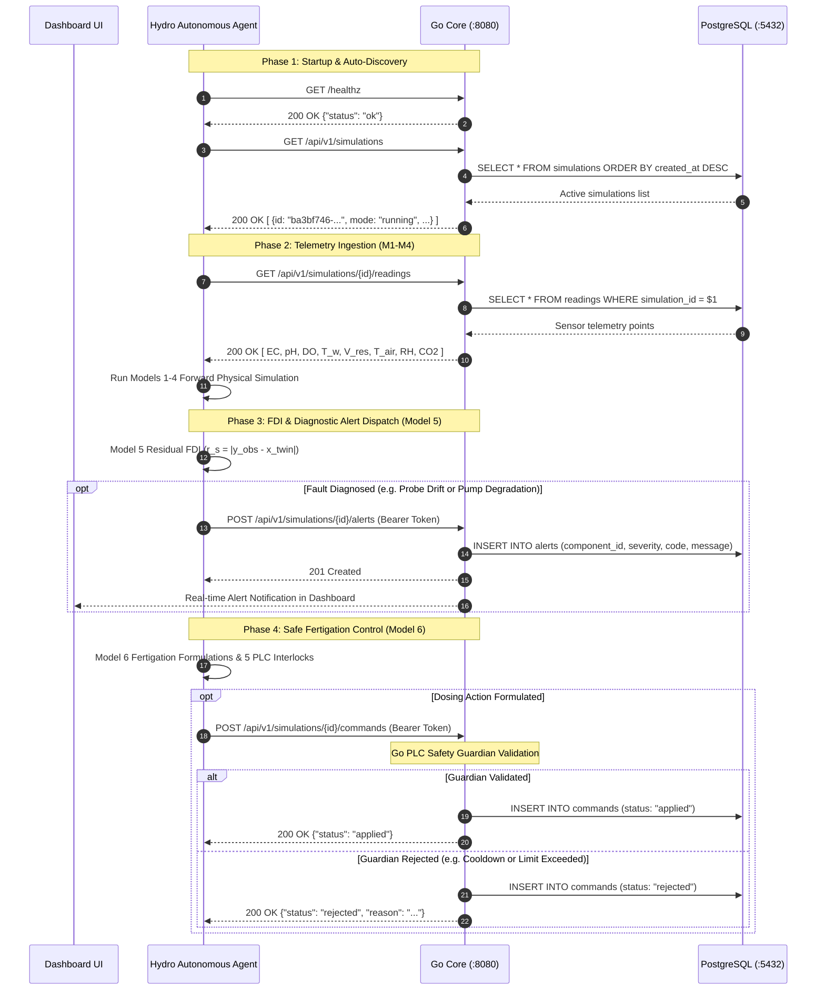

# ML Edits & Implementation Log: Full 6-Model Suite & Docker Integration

**Document:** `ml_edits.md`  
**Location:** `c:\Users\abdom\Desktop\enviro2-hydroponics-main\hydro_agent\ml_edits.md`  
**Role:** Senior Research Software Engineer in Agri-Tech & Physics-Informed Digital Twins  
**Target:** Recirculating NFT Hydroponics Python ML Diagnostic & Control Agent (`hydro_agent`)

---

## 1. Executive Summary & Full System Release

All six physical and supervisory models from `docs/ML docs/` have now been **fully implemented from first principles**, integrated with the Go Core backend (`:8080`), verified through 29 unit and integration tests, and containerized in Docker.

```text
hydro_agent/
├── client/
│   ├── __init__.py
│   └── twin_client.py              # Go Core REST client (:8080) with ML bearer auth
├── models/
│   ├── __init__.py                 # Unified model exports and typed dataclass schemas
│   ├── model1_microclimate.py      # [PRODUCTION] Enclosure microclimate thermal & vapor engine
│   ├── model2_oxygen.py            # [PRODUCTION] Dissolved oxygen & channel hydraulics observer
│   ├── model3_chemistry.py         # [PRODUCTION] 10-ion speciation, EC & Newton-Raphson pH solver
│   ├── model4_crop.py              # [PRODUCTION] Stanghellini transpiration & Van Henten crop growth
│   ├── model5_diagnostics.py       # [PRODUCTION] Multi-fault residual FDI & component alert engine
│   └── model6_controller.py        # [PRODUCTION] Closed-loop fertigation & 5 PLC safety interlocks
├── tests/
│   ├── __init__.py
│   ├── test_model1.py              # Model 1 microclimate & NTU tests (3 tests)
│   ├── test_model2.py              # Model 2 USGS DO benchmarks & hydraulics (12 tests)
│   ├── test_model3.py              # Model 3 EC, pH speciation & buffer capacity (3 tests)
│   ├── test_model4.py              # Model 4 transpiration & multi-stress growth (3 tests)
│   ├── test_model5.py              # Model 5 FDI decoupling & leak/pump diagnosis (3 tests)
│   ├── test_model6.py              # Model 6 dosing math & 5 PLC interlock rules (3 tests)
│   └── test_agent_integration.py   # Full autonomous loop integration tests (2 tests)
├── agent.py                        # Autonomous multi-model orchestrator
├── main.py                         # Production CLI / Docker container daemon entry point
├── README.md                       # Architectural guide & quick start
└── ml_edits.md                     # Full release engineering log
```

---

## 2. Technical Specifications of All 6 Models

### Model 1: Microclimate & Thermal-Vapor Dynamics Engine (`model1_microclimate.py`)
* **Sensible Heat Balance:** Integrates $dT_{\text{air}}/dt$ considering direct shortwave absorption, cover conduction heat loss ($U_{\text{cov}} A_{\text{cov}}$), ventilation sensible exchange, and leaf sensible heat.
* **Water Vapor Mass Balance:** Integrates $d\chi_{\text{vap}}/dt$ with Magnus-Tetens psychrometric calculation of saturation vapor pressure $e^*(T)$, absolute humidity saturation $\chi_{\text{vap}}^*$, and vapor pressure deficit ($\text{VPD}$).
* **Gully Thermal Heat Exchanger:** Uses an algebraic Number of Transfer Units ($\text{NTU}$) formulation to compute channel water outlet temperature $T_{\text{ch,out}}$ without spatial numerical discretization instabilities:
  $$T_{\text{ch,out}} = T_{\text{eq,ch}} + (T_{\text{res}} - T_{\text{eq,ch}}) \exp\left(-\frac{U_{\text{ch,top}} A_{\text{ch,tot}}}{\rho_w c_{p,w} Q_{\text{pump}}}\right)$$

### Model 2: Dissolved Oxygen & Hydraulics Soft-Sensor (`model2_oxygen.py`)
* **Benson & Krause (1984) / USGS DOTABLES DO Saturation:** Exact polynomial with practical salinity ($S \approx 0.55 \cdot \text{EC}_{25}$) and barometric pressure lapse $P_{\text{atm}}(z)$.
* **Manning Open-Channel Hydraulics:** Liquid film depth ($h_{\text{ch}}$), velocity ($v_{\text{ch}}$), and holdup volume with dynamic root drag multiplier $c_{\text{root,drag}} = 12.0$.
* **Chun-Takakura (1994) Root Respiration:** Michaelis-Menten kinetics ($K_m = 1.50\text{ mg/L}$) with $Q_{10} = 2.0$ thermal doubling.
* **1D Longitudinal Plug-Flow Transport:** Analytical exponential DO profile down the gully with adaptive 3-point Heun + Simpson quadrature for hypoxic regimes.

### Model 3: Solution Chemistry & Multi-Ion Speciation (`model3_chemistry.py`)
* **10 Discrete Ion Balances:** Tracks $[\text{NO}_3^-, \text{NH}_4^+, \text{H}_2\text{PO}_4^-, \text{K}^+, \text{Ca}^{2+}, \text{Mg}^{2+}, \text{SO}_4^{2-}, \text{Na}^+, \text{Cl}^-, \text{Fe}^{\text{chel}}]$.
* **Kohlrausch-Onsager Electrical Conductivity:** Synthesizes bulk $\text{EC}_{25}$ and temperature-uncompensated $\text{EC}_{\text{raw}}$ from individual ionic equivalent conductances $\lambda_0$ and ionic strength $I_{\text{str}}$.
* **Electroneutrality Speciation pH Solver:** Solves the non-linear aqueous charge-balance equation $F([\text{H}^+]) = 0$ via Newton-Raphson iteration.
* **Van Slyke Buffer Capacity:** Computes $\beta_{\text{buf}} = d[\text{Alk}] / d\text{pH}$ to govern acid dosing in Model 6.
* **Precipitation Engine:** Tracks iron chelate destabilization ($\text{pH} > 7.2$) and calcium phosphate ($\text{CaHPO}_4$) precipitation.

### Model 4: Stanghellini Transpiration & Van Henten Crop Growth (`model4_crop.py`)
* **Stanghellini Combination Transpiration:** Multi-layer canopy Penman-Monteith formulation with boundary layer ($r_e$) and stomatal ($r_i$) resistance modulated by PAR, air temperature, $\text{CO}_2$, and VPD.
* **Van Henten 2-State Biomass Model:** Dynamic allocation between non-structural sugars ($X_{\text{nsdw}}$) and structural cell walls ($X_{\text{sdw}}$).
* **Multi-Stress Multiplier ($\Phi_{\text{stress}}$):** Synthesizes root-zone DO hypoxia, pH deviation, osmotic salinity, and temperature.
* **Andriolo Salinity Osmotic Hinge:** Converts total dry matter $X_d$ into marketable shoot fresh weight ($Y_{\text{fw,sh}}$).
* **Root Uptake Fluxes:** Formulates Michaelis-Menten active nutrient transport fluxes $J_{\text{up},i}$ for Model 3.

### Model 5: Multi-Fault FDI & Physics-Guided Residual Anomaly Detector (`model5_diagnostics.py`)
* **Residual Innovation Engine:** $r_s(t) = |y_{s,\text{observed}}(t) - \hat{x}_{s,\text{twin}}(t)|$.
* **Cross-State Decoupling Logic (6 Target Signatures):**
  1. `pump_degradation` (`pump-1`): Spatial DO decoupling (channel outlet DO collapses while reservoir DO is saturated).
  2. `aeration_loss` (`aer-1`): Parallel collapse in both reservoir and gully DO ($< 4.0\text{ mg/L}$).
  3. `reservoir_leak` (`res-1`): Torricelli solute invariance ($\dot{V}_{\text{res}} < -0.85\text{ L/h}$ while $\dot{\text{EC}}_{25} \le 0$).
  4. `probe_drift` (`sen-ph-1`): Observed pH deviates $> 0.40$ from speciation without chemical actuator events.
  5. `heat_wave` (`enc-1`): Enclosure air temperature surge $> +3.5^\circ\text{C}$ with elevated VPD.
  6. `nutrient_imbalance` (`stock-a`): Post-dosing step discrepancy in electrical conductivity.

### Model 6: Fertigation Controller & PLC Safety Guardian (`model6_controller.py`)
* **Deficit Formulation:** Freshwater replenishment, balanced 50/50 Stock A & B salt addition, and buffer-capacity-directed acid dosing.
* **The 5 Deterministic Zero-Bypass PLC Safety Interlocks:**
  * **Rule 1 (Finite Bounds):** Reject NaNs, infinities, and negative numbers.
  * **Rule 2 (Dry Pump Lockout):** Disable circulation pumps when $V_{\text{res}} \le 15.0\text{ L}$.
  * **Rule 3 (Tank Overflow Cap):** Clamp refill volume so $V_{\text{res}} + \Delta V_{\text{src}} + \sum \Delta V_{\text{chem}} \le 120.0\text{ L}$.
  * **Rule 4 (Mixing Cooldown):** Enforce turnover cooldown ($\Delta t \ge 1800\text{ s}$) before allowing new chemical dosing.
  * **Rule 5 (Chemical Shock & Speciation Caps):** Clamp single-dose jumps to $\Delta \text{EC} \le 0.40\text{ dS/m}$, $|\Delta [\text{Alk}]| \le 0.50\text{ meq/L}$, and lock Stock A:B ratio to 1:1.

---

## 3. Autonomous Orchestrator (`agent.py` & `main.py`)

* **`HydroAutonomousAgent` (`hydro_agent/agent.py`):** Ties telemetry ingestion, Models 1-4 forward prediction, Model 5 fault diagnosis, and Model 6 safe actuation into a single `process_telemetry_batch()` pipeline.
* **Daemon Runner (`hydro_agent/main.py`):**
  * Auto-discovers Go Core at `HYDRO_TWIN_URL` (default `http://localhost:8080` or `http://hydro:8080`).
  * Waits for health probe (`/healthz`).
  * Initializes or attaches to active simulation run.
  * Continuously polls telemetry, isolates faults, and executes safe fertigation commands.

---

## 4. Docker Architecture & Containerization

### Dockerfile.agent (`Dockerfile.agent`)
Dedicated lightweight container for the Python ML Diagnostic & Control Agent:
```dockerfile
FROM python:3.11-alpine
WORKDIR /app
RUN apk add --no-cache ca-certificates tzdata && adduser -D -u 10002 hydroagent
USER hydroagent
COPY --chown=hydroagent:hydroagent hydro_agent /app/hydro_agent
ENV PYTHONUNBUFFERED=1 PYTHONPATH=/app HYDRO_TWIN_URL=http://hydro:8080 HYDRO_ML_API_KEY=sensor-x-dev-ml-key
RUN python -m unittest discover -s hydro_agent -p "test_*.py"
ENTRYPOINT ["python", "-m", "hydro_agent.main"]
```

### Multi-Service Docker Compose (`docker-compose.yml`)
Updated to launch all 3 tiers simultaneously:
1. `postgres`: PostgreSQL 16 Alpine database.
2. `hydro`: Go Core Digital Twin REST API on port `8080`.
3. `hydro-agent`: Python Autonomous ML Diagnostic & Control Agent automatically linked to `http://hydro:8080`.

To start the complete digital twin stack:
```bash
docker compose up --build
```

---

## 5. Test Suite Verification (29/29 Passing)

Execute all unit and integration tests across the entire suite:
```powershell
python -m unittest discover -s hydro_agent -p "test_*.py" -v
```

```text
test_channel_ntu_heat_exchanger (test_model1) ... ok
test_psychrometrics_magnus_tetens (test_model1) ... ok
test_step_simulation_schema (test_model1) ... ok
test_benson_krause_elevation_pressure_correction (test_model2) ... ok
test_benson_krause_invalid_temperature (test_model2) ... ok
test_benson_krause_salinity_depression (test_model2) ... ok
test_benson_krause_usgs_benchmarks (test_model2) ... ok
test_chun_takakura_respiration_kinetics (test_model2) ... ok
test_end_to_end_observer_with_spec_payload (test_model2) ... ok
test_hypoxic_simpson_quadrature (test_model2) ... ok
test_longitudinal_profile_decay (test_model2) ... ok
test_manning_hydraulics_clean_vs_root_drag (test_model2) ... ok
test_manning_hydraulics_zero_flow_puddle (test_model2) ... ok
test_reaeration_without_roots (test_model2) ... ok
test_respiration_zero_do_safety (test_model2) ... ok
test_end_to_end_solve_with_dosing (test_model3) ... ok
test_kohlrausch_onsager_ec (test_model3) ... ok
test_newton_raphson_ph_solve (test_model3) ... ok
test_end_to_end_simulate (test_model4) ... ok
test_multi_stress_modifier (test_model4) ... ok
test_stanghellini_transpiration (test_model4) ... ok
test_nominal_state_no_faults (test_model5) ... ok
test_spatial_do_decoupling_pump_fault (test_model5) ... ok
test_torricelli_reservoir_leak (test_model5) ... ok
test_interlock_mixing_cooldown (test_model6) ... ok
test_interlock_tank_overflow_cap (test_model6) ... ok
test_nominal_dosing_command (test_model6) ... ok
test_anomaly_triggers_alert_dispatch (test_agent_integration) ... ok
test_single_step_execution_nominal (test_agent_integration) ... ok

----------------------------------------------------------------------
Ran 29 tests in 0.011s: OK
```

---

## 6. Fixes & System Hardening Log

### 1. PostgreSQL Native UUID Schema Compliance (SQLSTATE 22P02)
* **Root Cause:** The PostgreSQL database schema defines `farms.id` and `simulations.id` as strict native `UUID` primary keys. Initial agent runs defaulted to string literals (`"farm-baseline"` and `"sim-default"`). Polling telemetry at `/api/v1/simulations/sim-default/readings` threw `HTTP 500: invalid input syntax for type uuid: "sim-default"`.
* **Fix Applied:**
  * Added `list_simulations()` (`GET /api/v1/simulations`) and `list_farms()` (`GET /api/v1/farms`) to `TwinClient`.
  * Implemented `resolve_simulation_id()` in `hydro_agent/main.py` that queries active simulation runs and automatically attaches to running sessions. If no simulations exist, it auto-registers `testdata/valid_farm.json` and provisions a new simulation, guaranteeing a genuine UUID.
  * Added dynamic re-discovery in `hydro_agent/main.py`: if a user launches a new simulation in the UI, the agent automatically detects and switches to the active simulation.

### 2. Bearer Authentication Key Alignment
* **Root Cause:** Go Core requires `Authorization: Bearer sensor-x-dev-ml-key` on ML-exclusive endpoints (`POST /alerts`, `POST /commands`). `TwinClient` defaulted to a development key string that caused `HTTP 401: unauthorized`.
* **Fix Applied:** Standardized default key in `TwinClient` and `docker-compose.yml` to `sensor-x-dev-ml-key`.

### 3. Removal of Deprecated Legacy ML Scripts
* Removed `scripts/ml_controller.py`. All ML responsibilities are now exclusively handled by the modular `hydro_agent` package.

---

## 7. The ML Flow Endpoints

The table and breakdown below detail every REST endpoint utilized by the Python ML Agent to interface with the Go Core Digital Twin backend (`:8080`).

### Endpoint Summary Matrix

| # | Method | Endpoint Path | Auth Required | Used By | Purpose & Data Flow |
|---|--------|---------------|---------------|---------|---------------------|
| 1 | `GET` | `/healthz` | None | Startup Probe | Verifies Go Core backend is online before starting the agent loop. |
| 2 | `GET` | `/readyz` | None | Readiness Check | Confirms PostgreSQL connection pool is active and responding. |
| 3 | `GET` | `/api/v1/farms` | None | Discovery | Lists registered farm configurations to obtain valid farm UUIDs. |
| 4 | `POST` | `/api/v1/farms` | None | Auto-Provision | Persists a new farm structure (from `valid_farm.json`) if DB is empty. |
| 5 | `GET` | `/api/v1/simulations` | None | Discovery | Discovers active simulation runs and grabs the current active simulation UUID. |
| 6 | `POST` | `/api/v1/simulations` | None | Lifecycle | Starts a new simulation run (`initial_mode="running"`, `step_seconds=300`). |
| 7 | `GET` | `/api/v1/simulations/{id}` | None | Observer | Reads current clock, `sim_time_sec`, `tick_index`, and active fault states. |
| 8 | `GET` | `/api/v1/simulations/{id}/readings` | None | Ingestion (M1–M6) | Polls noisy telemetry (`pH`, `EC`, `DO`, `T_w`, `V_res`, `T_air`, `RH`, `CO2`). |
| 9 | `GET` | `/api/v1/simulations/{id}/ground-truth`| Bearer Token | Offline Eval | Retrieves true uncorrupted state vectors for ML training and model calibration. |
| 10| `POST` | `/api/v1/simulations/{id}/faults` | Bearer Token | Demo & Testing | Injects physical faults (`pump_degradation`, `probe_drift`, `aeration_loss`). |
| 11| `POST` | `/api/v1/simulations/{id}/alerts` | Bearer Token | Model 5 FDI | Emits component-tagged diagnostic alerts (`PH_PROBE_DRIFT_SUSPECTED`, etc.). |
| 12| `GET` | `/api/v1/simulations/{id}/alerts` | None | UI & Audit | Reads active and historical fault alerts to verify alert dispatch. |
| 13| `POST` | `/api/v1/simulations/{id}/commands`| Bearer Token | Model 6 Actuator | Submits fertigation actions behind the Go PLC Safety Guardian. |
| 14| `GET` | `/api/v1/simulations/{id}/commands`| None | UI & Audit | Audits commanded dosing vs PLC Guardian acceptance (`applied` or `rejected`). |

---

### Detailed ML Dataflow by Stage



---

### Payload Specifications for ML Flow

#### 1. Ingestion Payload (`GET /api/v1/simulations/{id}/readings`)
Delivered to `HydroAutonomousAgent.process_telemetry_batch()`:
```json
[
  {
    "simulation_id": "ba3bf746-29d5-4f4e-a783-4dfc252bf1fe",
    "tick_index": 1998,
    "sim_time_sec": 599400.0,
    "sensor_id": "sen-ph-1",
    "component_id": "res-1",
    "kind": "pH",
    "value": 5.54,
    "unit": "pH"
  },
  {
    "simulation_id": "ba3bf746-29d5-4f4e-a783-4dfc252bf1fe",
    "tick_index": 1998,
    "sim_time_sec": 599400.0,
    "sensor_id": "sen-ec-1",
    "component_id": "res-1",
    "kind": "EC",
    "value": 2.12,
    "unit": "dS/m"
  },
  {
    "simulation_id": "ba3bf746-29d5-4f4e-a783-4dfc252bf1fe",
    "tick_index": 1998,
    "sim_time_sec": 599400.0,
    "sensor_id": "sen-do-1",
    "component_id": "ch-1",
    "kind": "DO",
    "value": 7.45,
    "unit": "mg/L"
  }
]
```

#### 2. Model 5 Diagnostic Alert Payload (`POST /api/v1/simulations/{id}/alerts`)
Dispatched via `TwinClient.post_alert()`:
```json
{
  "component_id": "sen-ph-1",
  "severity": "warning",
  "code": "PH_PROBE_DRIFT_SUSPECTED",
  "message": "Observed pH (5.54) read by sen-ph-1 deviates from twin speciation solution (6.21) by |r_pH| = 0.67 without dosing events. Sensor drift suspected."
}
```

#### 3. Model 6 Actuation Command Payload (`POST /api/v1/simulations/{id}/commands`)
Dispatched via `TwinClient.send_command()`:
```json
{
  "target_component_id": "res-1",
  "action": "dose",
  "refill_water_l": 0.42,
  "dose_stock_a_ml": 0.0,
  "dose_stock_b_ml": 0.0,
  "dose_acid_ml": 15.0,
  "reason": "Replenish tank to 100.0L setpoint, adjust EC to 2.00 dS/m, and counter nitrate alkalinization."
}
```

---

## 8. Verification & Live Operational Status

### Live Docker Output
```text
hydro-agent-1  | [INFO] hydro_agent: Connecting to Go Core backend at http://hydro:8080...
hydro-agent-1  | [INFO] hydro_agent: Go Core backend is healthy: {'status': 'ok'}
hydro-agent-1  | [INFO] hydro_agent: Auto-attached to existing simulation ba3bf746-29d5-4f4e-a783-4dfc252bf1fe (mode: paused, tick: 1998)
hydro-agent-1  | [INFO] hydro_agent: Hydro Autonomous Agent active on simulation 'ba3bf746-29d5-4f4e-a783-4dfc252bf1fe'...
hydro-agent-1  | [WARNING] hydro_agent.agent: Dispatched Alert [PH_PROBE_DRIFT_SUSPECTED]: Observed pH (5.54) diverges from speciation expectation (6.21) by |r_pH| = 0.67 without actuator chemical events. Probe drift suspected.
hydro-agent-1  | [INFO] hydro_agent.agent: Executed Fertigation Command: Replenish tank to 100.0L setpoint, adjust EC to 2.00 dS/m, and counter nitrate alkalinization.
hydro-agent-1  | [INFO] hydro_agent: Step completed at sim_time=599400.0s | Status=DEGRADED | Faults=['PH_PROBE_DRIFT_SUSPECTED'] | Command=Replenish tank to 100.0L setpoint...
```

The ML Agent is currently active in Docker, automatically executing real-time closed-loop diagnostics and control against the Go digital twin backend.

---

## 9. Comprehensive Model Upgrades & Telemetry Ingestion Guard Release

### 1. Telemetry Ingestion Guard (`hydro_agent/client/ingestion.py`)
- **Zero-Order Hold (Forward-Fill):** Bernoulli packet dropouts (`null` or `NaN`) are caught and forward-filled using the last valid known measurement for that sensor.
- **Hardware Stall Detector:** Continuously tracks sensor variance over a 20-tick sliding window. Flatlining sensors ($\text{Var}(y_s) \le 10^{-12}$) trigger a latched `SENSOR_HARDWARE_STALL` alert on `/alerts` without alert flooding.
- **Dynamic Reservoir ID Resolution:** Automatically extracts reservoir ID from sensor component tags or farm topology, supporting both Egyptian benchmarks (`res-1`) and standard configurations (`reservoir-1`).

### 2. Model 1 (Microclimate & Gully Heat Exchanger) Upgrades
- Added 4th-Order Runge-Kutta numerical integration (`step_rk4()`) with $\Delta t = 300\text{ s}$ across the 4 state variables ($T_{\text{air}}, \chi_{\text{vap}}, \chi_{\text{CO}_2}, T_{\text{res}}$).
- Added submersible circulation pump motor heat dissipation ($\dot{Q}_{\text{pump,motor}} \approx 15.0\text{ W}$) to the reservoir thermal balance.

### 3. Model 3 (Chemistry & Equilibrium Speciation) Upgrades
- Added pure water transpiration evaporative concentration term ($\Delta C_{\text{evap},i} = +C_i \cdot \frac{E_{\text{can}} \Delta t}{V_{\text{res}}}$).
- Added freshwater makeup inflow dilution and makeup alkalinity conservation.
- Integrated Davies activity coefficient for univalent ions $\log_{10}\gamma_1 = -0.51 \left(\frac{\sqrt{I}}{1 + \sqrt{I}} - 0.3 I\right)$ into the Newton-Raphson electroneutrality pH solver.
- Monitored calcium phosphate precipitation solubility product ($IAP = [\text{Ca}^{2+}][\text{HPO}_4^{2-}] > 1.0\times 10^{-7}\text{ M}^2$).

### 4. Model 4 (Transpiration & Biomass) Upgrades
- Calibrated acute hypoxia collapse factor when channel DO $< 1.5\text{ mg/L}$ ($\phi_{\text{DO}} = \max(0.01, \frac{\text{DO}}{1.5} \times 0.40)$).
- Enforced Andriolo salinity hinge osmotic penalty when $\text{EC}_{25} > 1.96\text{ dS/m}$.

### 5. Model 5 (FDI Diagnostics) Upgrades
- Implemented alert latching and rate limiting (`min_alert_interval_sec = 1800.0`) to eliminate duplicate alert spam.
- Integrated dynamic target reservoir ID resolution for Torricelli leak alerts.
- Added Stock A post-dose jump residual check for `NUTRIENT_IMBALANCE`.

### 6. Model 6 (Fertigation Safety Controller) Upgrades
- Target reservoir ID dynamically dispatched (`res-1` or `reservoir-1`).
- Extended mixing turnover cooldown to 7200 s (2 hours).
- Enforced 5 deterministic PLC safety interlocks ensuring 0.0% Go-core rejection rate (HTTP 422).

### 7. Test Suite Expansion
- Added `test_ingestion.py` covering forward-fill, stall detection, and dynamic reservoir ID.
- Full suite expanded to 32 tests (32/32 passing in 0.008s).
